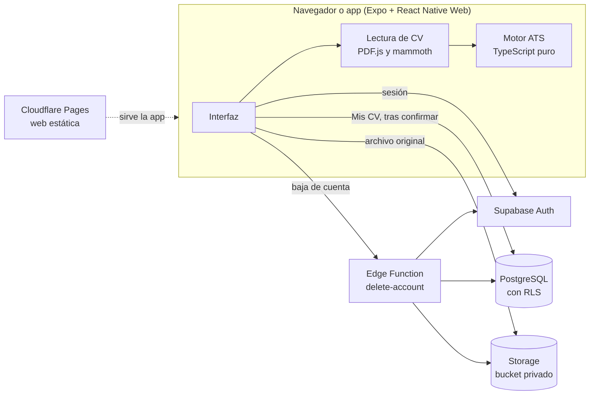

<div align="center">
  

  <h1>JobRadar ATS</h1>

  <p>
    Compara tu CV con una oferta de empleo, requisito a requisito, y descubre qué puedes demostrar y qué te falta.<br />
    El análisis se hace en tu dispositivo.
  </p>

  <p>
    <a href="https://jobradar-ats.pages.dev"><strong>jobradar-ats.pages.dev</strong></a>
    ·
    <a href="docs/roadmap.md">Roadmap</a>
    ·
    <a href="docs/architecture.md">Arquitectura</a>
  </p>
</div>

> [!NOTE]
> **Estado.** La última publicación comprobada en Cloudflare Pages es la **v1.5**: analizador ATS, importación de CV, cuentas, «Mis CV», extracción bilingüe y relaciones semánticas locales (v1.4) y rediseño responsive (v1.5). La **v1.6**, con el diseño inmersivo de Inicio y Analizar, está fusionada en `main` (PR #14); no se ha verificado un despliegue posterior. La **v1.7** está en `feat/v1.7-motor-ats`, pendiente de revisión y publicación. Detalle en [Estado de las funcionalidades](#estado-de-las-funcionalidades).

## Índice

- [Qué es JobRadar ATS](#qué-es-jobradar-ats)
- [Estado de las funcionalidades](#estado-de-las-funcionalidades)
- [Tecnologías](#tecnologías)
- [Arquitectura](#arquitectura)
- [Primeros pasos](#primeros-pasos)
- [Estructura del repositorio](#estructura-del-repositorio)
- [Seguridad y privacidad](#seguridad-y-privacidad)
- [Limitaciones conocidas](#limitaciones-conocidas)
- [Roadmap](#roadmap)
- [Documentación](#documentación)
- [Atribuciones de terceros](#atribuciones-de-terceros)
- [Licencia](#licencia)

## Qué es JobRadar ATS

Una aplicación gratuita para **personas que buscan empleo**. Lee un CV en PDF o Word, lo compara con el texto de una oferta y muestra, para cada requisito, si el CV lo respalda con evidencias, solo lo menciona o no lo acredita, junto con recomendaciones para mejorarlo.

Principios del producto:

- **Simula el análisis de un ATS.** JobRadar analiza la compatibilidad de tu CV con una oferta utilizando criterios habituales de evaluación de los sistemas ATS (_Applicant Tracking System_), con herramientas como Jobscan como referencia, e identifica oportunidades para mejorar tu candidatura. No usa el algoritmo de ningún ATS comercial concreto (Workday, Greenhouse, Lever…).
- **Explicable.** Cada resultado muestra el motivo y las frases del CV en que se basa.
- **No inventa datos.** Las recomendaciones nunca sugieren añadir experiencia, titulaciones ni habilidades que el usuario no tenga.
- **Local y voluntario.** El análisis se hace en el dispositivo. Solo se guarda un CV en la cuenta si el usuario lo decide y lo confirma.
- **Presupuesto de 0 €.** Solo herramientas y planes gratuitos.

## Estado de las funcionalidades

«Probado en local» quiere decir que hay pruebas automáticas (Jest) o recorridos en Chromium sobre la compilación web. «En producción», que funciona en [jobradar-ats.pages.dev](https://jobradar-ats.pages.dev), publicado con Cloudflare Pages. La presencia de la v1.4 y la v1.5 en producción se comprobó el 15 de noviembre de 2026 sobre la web publicada. «Experimental» indica una función opcional y marcada como tal en la interfaz.

| Funcionalidad                                                                                                               | Versión | Implementado | Probado en local | En producción |
| --------------------------------------------------------------------------------------------------------------------------- | ------- | ------------ | ---------------- | ------------- |
| Analizador CV–oferta: requisitos, evidencias, cobertura explicable y recomendaciones                                        | v1.0    | Sí           | Sí               | Sí            |
| Análisis local y determinista: reglas fijas en TypeScript, sin IA ni servidor                                               | v1.0    | Sí           | Sí               | Sí            |
| Importación de CV en PDF y DOCX (web), con avisos de lectura y revisión del texto                                           | v1.0    | Sí           | Sí               | Sí            |
| Identidad visual, rediseño de la interfaz y temas claro y oscuro                                                            | v1.1    | Sí           | Sí               | Sí            |
| Cuentas con Supabase Auth: registro con confirmación, acceso, sesión y recuperación de contraseña                           | v1.2    | Sí           | Sí               | Sí            |
| **Mis CV**: guardar varios CV de forma voluntaria y analizarlos, renombrarlos o eliminarlos desde cualquier dispositivo     | v1.3    | Sí           | Sí               | Sí            |
| **Eliminación de cuenta** con sus archivos y datos, mediante una Edge Function                                              | v1.3    | Sí           | Sí               | Sí            |
| **Página de privacidad** (`/privacidad`), con la base jurídica y las transferencias aún pendientes                          | v1.3    | Sí           | Sí               | Sí            |
| Requisitos de ofertas en español e inglés, limpieza de páginas completas de LinkedIn y catálogo ampliado con sinónimos ESCO | v1.4    | Sí           | Sí               | Sí            |
| **Relaciones semánticas** locales y opcionales con `multilingual-e5-small`: sugerencias que no cambian la cobertura         | v1.4    | Sí           | Sí               | Experimental  |
| Rediseño responsive, accesibilidad en modo oscuro y Resultados ATS agrupados por estado                                     | v1.5    | Sí           | Sí               | Sí            |
| **Diseño inmersivo** en la web: Inicio con radar interactivo y escena ligada al desplazamiento, transición y Analizar       | v1.6    | Fusionada    | Sí               | Sí            |
| **Motor ATS v1.7**: secciones en inglés, alternativas, niveles con palabras, años por ámbito, ISO y representatividad       | v1.7    | En una rama  | Sí               | Sí            |
| Importación de archivos en la app nativa (iOS y Android)                                                                    | —       | No           | —                | —             |

Comprobaciones del responsable en el proyecto real de Supabase, registradas al cerrar la v1.3:

- **Migraciones:** las tres de `supabase/migrations/` están aplicadas, y el script de aislamiento entre cuentas no ha dado fallos.
- **Mis CV:** guardar, reutilizar y eliminar CV funciona con el proyecto real.
- **Baja de cuenta:** la Edge Function `delete-account` está desplegada, y la baja de una cuenta de prueba eliminó el usuario de Auth, sus registros en PostgreSQL y sus archivos en Storage.
- **Recuperación de contraseña en producción:** llega el correo, se establece la nueva contraseña y el cambio queda confirmado.

## Tecnologías

Versiones tomadas de [`package.json`](package.json).

| Área               | Tecnología                                                                                                     |
| ------------------ | -------------------------------------------------------------------------------------------------------------- |
| Plataforma         | Expo SDK 58 (`expo` ~58.0.22), React Native 0.88, React 19.3                                                   |
| Web                | React Native Web 0.21, exportación estática (`web.output: "static"`)                                           |
| Navegación         | Expo Router 58, con rutas basadas en archivos en `src/app/`                                                    |
| Lenguaje           | TypeScript 6 en modo `strict`                                                                                  |
| Lectura de CV      | PDF.js (`pdfjs-dist` 6.4.299) para PDF y mammoth 1.13 para DOCX, en el navegador                               |
| Análisis semántico | `multilingual-e5-small` (ONNX), `onnxruntime-web` 1.31 y `@huggingface/tokenizers` 0.2, en un Web Worker       |
| Backend            | Supabase: Auth, PostgreSQL con RLS, Storage privado y Edge Functions (Deno), con `@supabase/supabase-js` 2.119 |
| Sesión en nativo   | `expo-secure-store`                                                                                            |
| Alojamiento web    | Cloudflare Pages como sitio estático (`public/_headers`, `public/404.html`)                                    |
| Pruebas            | Jest 30, `jest-expo` y React Native Testing Library 14                                                         |
| Calidad de código  | ESLint 9 (`eslint-config-expo`) y Prettier 3                                                                   |
| Interfaz           | Inter (fuente incluida con la app) e iconos con `expo-symbols`                                                 |

## Arquitectura



- **El motor ATS se ejecuta en el dispositivo.** Es TypeScript puro, sin dependencias de interfaz ni red. El CV y la oferta que se analizan nunca se envían a un servidor.
- **El modelo semántico también es local.** Solo se descarga si el usuario lo activa, desde el propio dominio (`/semantic/`); el navegador comprueba su SHA-256 y lo ejecuta en un Web Worker.
- **Supabase solo interviene con cuenta.** Gestiona la sesión y, si el usuario lo confirma, guarda el CV (texto en PostgreSQL y archivo en Storage). Cada operación está limitada a su propietario mediante RLS.
- **La clave secreta solo existe en Supabase.** La app usa la clave publicable; la baja de cuenta, que necesita privilegios, la ejecuta la Edge Function en el servidor.
- **Módulos por funcionalidad** en `src/features/`, con capas `domain`, `application`, `infrastructure` y `presentation` cuando hay contenido real para ellas. Ver [docs/architecture.md](docs/architecture.md).

## Primeros pasos

### Requisitos

- Node.js compatible con Expo SDK 58 (`^22.13.0` o `^24.3.0` y posteriores; el desarrollo usa Node 24) y npm.
- Git.

### Instalación

```bash
git clone <url-del-repositorio>
cd jobradar-ats
npm install
```

### Variables de entorno

Las cuentas necesitan un proyecto de Supabase. Crea `.env.local`, que Git ignora:

```dotenv
EXPO_PUBLIC_SUPABASE_URL=https://<proyecto>.supabase.co
EXPO_PUBLIC_SUPABASE_PUBLISHABLE_KEY=sb_publishable_<clave-publica>
```

Las dos son **públicas**: se incorporan al bundle web. Nunca uses aquí una clave `sb_secret_`, la `service_role` ni contraseñas de base de datos; la app rechaza cualquier clave que no sea publicable. Sin estas variables, el analizador funciona y el acceso con cuenta queda desactivado.

La configuración de Supabase (Auth, migraciones, Storage y la Edge Function) está en [docs/auth.md](docs/auth.md) y [docs/mis-cv.md](docs/mis-cv.md).

### Ejecución

```bash
npm run web   # servidor de desarrollo con la versión web
npm start     # servidor de desarrollo de Expo
```

### Pruebas y calidad

```bash
npm test                        # Jest + React Native Testing Library
npm run lint                    # ESLint
npm run typecheck               # TypeScript (tsc --noEmit)
npm run format:check            # Prettier, incluidos los .md
```

### Compilación web y despliegue

```bash
npm run build:web   # expo export, pasos para Cloudflare y modelo semántico; genera dist/, ignorado por Git
```

`build:web` ejecuta `expo export --platform web`, después [`scripts/move-vendor-assets.cjs`](scripts/move-vendor-assets.cjs), que mueve los recursos de las dependencias de `dist/assets/node_modules/` a `dist/assets/vendor/` porque Cloudflare Pages no publica esa carpeta, y por último [`scripts/prepare-semantic-model.cjs`](scripts/prepare-semantic-model.cjs), que prepara en `dist/semantic/` el modelo de las relaciones semánticas. `npx expo export` a secas no incluye ese modelo: en esa compilación el panel semántico indica que no está disponible.

**Cloudflare Pages** es el hosting definitivo de la web (<https://jobradar-ats.pages.dev>) y despliega automáticamente `main`. Las cabeceras de seguridad y caché están en `public/_headers`, y la página 404 en `public/404.html`. Las variables `EXPO_PUBLIC_*` se definen en el panel del proyecto de Cloudflare.

Configuración, origen de autenticación en Supabase y retirada de Vercel, el hosting anterior: [docs/deploy.md](docs/deploy.md).

### Probar en iPhone desde Windows

El proyecto se desarrolla en Windows y con 0 € de presupuesto:

- **Web en Safari:** abre [jobradar-ats.pages.dev](https://jobradar-ats.pages.dev) y añádela con «Compartir → Añadir a pantalla de inicio». También puedes ejecutar `npm run web` en el PC y abrir en Safari la dirección de red del PC (`http://<IP-del-PC>:8081`), con los dos dispositivos en la misma red Wi-Fi.
- **No disponibles:** Expo Go de la App Store no es compatible con el SDK 58, el simulador de iOS (`npm run ios`) solo existe en macOS, y TestFlight requiere una membresía de pago.

## Estructura del repositorio

```text
src/
  app/                  Rutas de Expo Router (ligeras: solo montan pantallas)
  features/
    cv-match/           Motor ATS (domain) y pantallas del analizador
    cv-import/          Lectura de CV en PDF y DOCX
    auth/               Supabase Auth: acceso, sesión, callback y baja de cuenta
    my-cvs/             «Mis CV»: lista, guardado con confirmación y traspaso al analizador
    privacy/            Página de privacidad
    home/               Inicio inmersivo en web y pantalla nativa
  shared/               Sistema de diseño (tokens y componentes), navegación y utilidades
supabase/
  migrations/           Tablas, índices, RLS y políticas de Storage
  functions/            Edge Function delete-account
  tests/                Prueba de aislamiento entre cuentas para el SQL Editor
__tests__/              Pruebas de Jest
jest/                   Utilidades y documentos ficticios para las pruebas
docs/                   Documentación técnica
scripts/                Paso posterior a la exportación web y prueba de humo de Auth
assets/                Fuentes, logo e iconos
public/                Iconos, manifiesto, cabeceras (_headers) y página 404 del hosting
```

## Seguridad y privacidad

- **Análisis local.** El CV y la oferta se analizan en el dispositivo y no se envían a ningún servidor.
- **Guardado voluntario.** Un CV solo se guarda si el usuario pulsa «Guardar en Mis CV» y confirma la cuenta de destino. Se guardan el archivo original y el texto que se analiza.
- **RLS y permisos mínimos.** Cada operación sobre `public.cvs` se limita a su propietario con `auth.uid()`. El rol `anon` no tiene acceso, y el texto y el archivo guardados no se pueden modificar, solo renombrar o eliminar.
- **Bucket privado.** Los archivos están en `cvs/<id-de-usuario>/`, con un máximo de 10 MB y solo PDF o DOCX. No se puede subir un archivo sin su registro ni escribir en la carpeta de otro usuario.
- **Baja de cuenta.** Desde «Mi cuenta», con confirmación por email: se borran los archivos, después los registros y por último la cuenta. Si el proceso se detiene a mitad, se informa del paso y se puede repetir.
- **Sin secretos en el cliente.** Solo variables `EXPO_PUBLIC_*` con valores públicos; los archivos `.env*` no se versionan.
- **Información al usuario.** La página `/privacidad` explica qué datos se tratan, dónde y cómo eliminarlos. Hay aspectos pendientes de decisión del responsable; ver el [roadmap](docs/roadmap.md#cumplimiento-y-privacidad).

Estas medidas reducen riesgos, pero no constituyen una garantía de seguridad ni una revisión jurídica.

## Limitaciones conocidas

- **Motor basado en reglas, para ofertas en español e inglés.** Usa un catálogo cerrado de habilidades; lo que no reconoce se marca como no evaluable en lugar de adivinarse.
- **Relaciones semánticas solo en la web**, en navegadores con Web Workers de módulo, WebAssembly SIMD y `crypto.subtle`.
- **Sin OCR.** Los PDF escaneados no se leen; se puede pegar el texto.
- **Importación solo en la web.** En la app nativa se pega el texto del CV.
- **Sin modo sin conexión.** La web no tiene service worker.

## Roadmap

| Versión | Contenido                                                                                        | Estado                            |
| ------- | ------------------------------------------------------------------------------------------------ | --------------------------------- |
| v1.0    | Analizador CV–oferta e importación PDF/DOCX en la web, publicado en Vercel (hosting anterior)    | Publicada (PR #1)                 |
| v1.1    | Identidad visual, rediseño y mejoras de lectura de PDF                                           | Publicada (PR #2 a #5)            |
| v1.2    | Cuentas con Supabase Auth y refuerzo de seguridad de sesiones                                    | Publicada (PR #6 y #7)            |
| v1.3    | Mis CV, eliminación de cuenta y página de privacidad                                             | Publicada (PR #8, #10 y #11)      |
| v1.4    | Extracción bilingüe, catálogo ampliado y relaciones semánticas locales (`multilingual-e5-small`) | Publicada (`ec2301b` en `main`)   |
| v1.5    | Rediseño responsive, accesibilidad y Resultados ATS                                              | Publicada (PR #13)                |
| v1.6    | Diseño inmersivo integrado en Inicio y Analizar                                                  | Fusionada en `main` (PR #14)      |
| v1.7    | Motor ATS: evidencias breves, alternativas, idiomas, experiencia y representatividad             | Lista para revisión, sin publicar |

Infraestructura: Cloudflare Pages es el hosting de la web desde la PR #9. Vercel, el hosting anterior, se ha retirado del repositorio y `jobradar-ats.vercel.app` ya no sirve la app; quedan pasos de [limpieza en remoto](docs/deploy.md#retirada-de-vercel-proveedor-anterior) que no constan como hechos.

Dominio: el subdominio `jobradar-ats.is-a.dev` fue rechazado. La web seguirá en `jobradar-ats.pages.dev` y no se buscarán más dominios gratuitos.

Pendiente: completar la información de privacidad (bases jurídicas y transferencias internacionales). Los correos de Auth personalizados quedan aplazados, porque necesitan un dominio propio. Detalle, cumplimiento y planes condicionados al crecimiento en [docs/roadmap.md](docs/roadmap.md).

## Documentación

- [docs/roadmap.md](docs/roadmap.md): versiones, próximos pasos, cumplimiento y dominio.
- [docs/architecture.md](docs/architecture.md): arquitectura, motor ATS, importación, decisiones y riesgos.
- [docs/auth.md](docs/auth.md): configuración de Supabase Auth y verificación.
- [docs/mis-cv.md](docs/mis-cv.md): «Mis CV», migraciones, aislamiento, baja de cuenta y privacidad.
- [docs/deploy.md](docs/deploy.md): publicación en Cloudflare Pages, origen de autenticación en Supabase y retirada de Vercel.
- [CLAUDE.md](CLAUDE.md) y [AGENTS.md](AGENTS.md): reglas de trabajo para asistentes de IA.

## Atribuciones de terceros

- **Inter**, de Rasmus Andersson. Copyright 2016 The Inter Project Authors. Licencia [SIL Open Font License 1.1](assets/fonts/OFL.txt). Archivos estáticos Regular, Medium, SemiBold y Bold sin modificar, de la versión 4.1 publicada en [rsms/inter](https://github.com/rsms/inter/releases/tag/v4.1): OTF para iOS y Android y WOFF2 para la web. Se distribuyen con la app; la web no los pide a ningún servicio externo.
- **Material Symbols**, de Google. Licencia Apache 2.0. Fuente de iconos que `expo-symbols` utiliza en Android y web, distribuida sin modificar mediante la dependencia `@expo-google-fonts/material-symbols` (su licencia está en `node_modules/@expo-google-fonts/material-symbols/LICENSE_FONT`). En iOS se usan los SF Symbols del sistema.
- **Otras dependencias incluidas en la web**, cada una con su licencia en `node_modules/`: PDF.js (`pdfjs-dist`, Apache 2.0), mammoth (BSD 2-Clause) y `@supabase/supabase-js` (MIT).

## Licencia

La licencia propia de JobRadar ATS está **pendiente de decisión**, y el repositorio es privado. El archivo [`LICENSE`](LICENSE) actual es la licencia MIT de la plantilla de Expo (copyright de 650 Industries, Inc.) y se conserva sin cambios; no es una licencia elegida para JobRadar. Ver [docs/architecture.md](docs/architecture.md#cuestiones-pendientes-no-técnicas).
