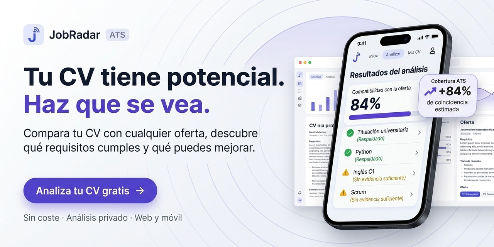

<div align="center">
  
  <h1>JobRadar ATS</h1>
  <p><strong>Entiende cómo encaja tu CV con la oferta que te interesa.</strong></p>
  <p>Compara requisitos, revisa las evidencias de tu experiencia y descubre mejoras concretas.<br />El análisis se ejecuta en tu dispositivo.</p>
  <p>
    <a href="https://jobradar-ats.pages.dev"><strong>Abrir JobRadar</strong></a>
    · <a href="docs/architecture.md">Arquitectura</a>
    · <a href="docs/roadmap.md">Roadmap</a>
    · <a href="#contribuir">Contribuir</a>
  </p>
</div>

## De tu CV a un resultado explicable

JobRadar es una plataforma gratuita de análisis ATS en evolución hacia una evaluación híbrida más inteligente. Compara tu CV con una oferta y descubre qué requisitos respalda tu experiencia, cuáles necesitan más evidencia y cuáles no se pueden evaluar. Pega el texto o importa un PDF/DOCX en la web.

- **Análisis requisito a requisito:** extracción de ofertas en español e inglés, alternativas entre competencias, idiomas y experiencia.
- **Evidencias y recomendaciones:** motivos legibles y frases literales del CV, con consejos para expresar lo que realmente has hecho.
- **Cobertura transparente:** porcentaje, criterios y puntos visibles; los requisitos no evaluables quedan fuera del cálculo y se avisa cuando el resultado representa solo una parte de la oferta.
- **Comparación entre análisis:** revisa qué cambia al editar tu CV para la misma oferta durante la sesión.
- **Mis CV, con cuenta opcional:** guarda documentos tras confirmarlo, reutilízalos, renómbralos o elimínalos. Incluye recuperación de acceso y eliminación de cuenta.
- **Experiencia web responsive:** Inicio inmersivo, temas claro y oscuro y navegación adaptada al móvil.
- **Relaciones semánticas opcionales:** `multilingual-e5-small` sugiere relaciones entre requisitos y evidencias en el dispositivo. Es experimental y no modifica la cobertura determinista.

La evolución combina reglas explicables, comprensión semántica local e investigación con modelos generativos Qwen en experimentos independientes. Esa línea generativa todavía no está integrada en el producto. Consulta el [estado y la dirección de IA](docs/roadmap.md#evaluación-híbrida-estado-y-evolución).

**v1.7 está fusionada en `main` mediante la PR #15.** La aplicación está disponible en [jobradar-ats.pages.dev](https://jobradar-ats.pages.dev); este repositorio no acredita un despliegue concreto de v1.7. Consulta sus [resultados de validación y límites](docs/v1.7-validation.md).

## Tecnología y privacidad

| Área                    | Tecnología                                                          |
| ----------------------- | ------------------------------------------------------------------- |
| Aplicación y navegación | Expo SDK 58, React Native, React Native Web y Expo Router           |
| Lenguaje y motor        | TypeScript; reglas deterministas y evidencias trazables             |
| Lectura de documentos   | PDF.js y mammoth, en el navegador                                   |
| Cuentas y biblioteca    | Supabase Auth, PostgreSQL con RLS, Storage privado y Edge Functions |
| Publicación web         | Exportación estática en Cloudflare Pages                            |
| Calidad                 | Jest, React Native Testing Library, ESLint y Prettier               |

El proyecto se organiza por funcionalidades en `src/features/`; las rutas de `src/app/` montan las pantallas y los componentes compartidos viven en `src/shared/`. El motor de análisis es TypeScript independiente de la interfaz y de la red.

La lectura del documento y la comparación CV–oferta se realizan localmente. La cuenta es opcional: **solo al confirmar el guardado en Mis CV se envían el texto y el archivo a Supabase**. Reutilizar un CV guardado descarga su texto para analizarlo en el dispositivo. Las migraciones incluyen acceso por propietario mediante RLS y un bucket privado. El modelo semántico opcional se descarga desde el dominio de la aplicación y se ejecuta en un Web Worker.

Más información: [arquitectura](docs/architecture.md), [cuentas](docs/auth.md), [Mis CV](docs/mis-cv.md) y [privacidad de la aplicación](https://jobradar-ats.pages.dev/privacidad).

## Desarrollo local

Necesitas Git, Node.js 24.x y npm.

```bash
git clone https://github.com/jorgearcenic7/jobradar-ats.git
cd jobradar-ats
npm ci
npm run web
```

El analizador funciona sin configurar una cuenta.

Para habilitar las funciones de cuenta en tu entorno, configura **tu propio proyecto de Supabase** y crea `.env.local`, ignorado por Git:

```dotenv
EXPO_PUBLIC_SUPABASE_URL=https://<tu-proyecto>.supabase.co
EXPO_PUBLIC_SUPABASE_PUBLISHABLE_KEY=sb_publishable_<tu-clave-publica>
```

Estas variables son públicas y se incorporan a la compilación. Nunca pongas una clave secreta, `service_role` o una contraseña de base de datos en `EXPO_PUBLIC_*`. La configuración de Auth, las migraciones y la función de eliminación se describen en [auth.md](docs/auth.md) y [mis-cv.md](docs/mis-cv.md).

```bash
npm start          # servidor de desarrollo de Expo
npm run build:web  # distribución web completa en dist/
```

`build:web` prepara también los recursos de dependencias y el modelo semántico existente; la primera ejecución puede descargar sus pesos y las siguientes usan caché local. Para una exportación básica: `npx expo export --platform web`. Configuración de Cloudflare Pages: [deploy.md](docs/deploy.md).

## Pruebas

```bash
npm test -- --runInBand
npm run lint
npm run typecheck
npm run format:check
npx expo export --platform web
```

Usa siempre datos ficticios. Las pruebas están en `__tests__/` y sus utilidades en `jest/`. El recorrido opcional [v17-web-smoke.cjs](jest/v17-web-smoke.cjs) comprueba la web con Playwright ya instalado y respuestas de cuenta ficticias; no añade una dependencia a la aplicación.

## Contribuir

Para errores funcionales, describe cómo reproducirlos con un CV y una oferta ficticios. Para cambios de código, plantea un alcance concreto y aporta las verificaciones anteriores. No incluyas documentos reales, credenciales ni datos personales en issues, pull requests, capturas o logs. Consulta las convenciones del proyecto en [AGENTS.md](AGENTS.md) y [CLAUDE.md](CLAUDE.md).

Los posibles fallos de seguridad se comunican **en privado** según [SECURITY.md](SECURITY.md). El código es público para su consulta, con derechos reservados sobre el contenido propio; antes de reutilizarlo o aportar código, revisa [LICENSE](LICENSE) y acuerda con el responsable los permisos que correspondan.

## Límites y siguientes pasos

JobRadar aplica criterios habituales de análisis ATS; no reproduce el algoritmo de un proveedor comercial ni garantiza decisiones de selección. El catálogo y las reglas tienen límites, especialmente en credenciales, titulaciones alternativas y equivalencias ambiguas. Revisa siempre los requisitos no evaluados.

La importación de PDF/DOCX está disponible en la web; en las plataformas nativas se aporta texto. No hay OCR para documentos escaneados. La verificación de Safari real, accesibilidad nativa y otras limitaciones se detalla en el [roadmap](docs/roadmap.md). OCR, importación nativa e historial de candidaturas son trabajo futuro, no funciones actuales.

## Licencia y atribuciones

**Código público, con derechos reservados sobre el contenido propio.** Por decisión del propietario, JobRadar no concede por ahora permisos generales de reutilización, modificación, redistribución o comercialización de su código propio. No se presenta como un proyecto con licencia open source. Consulta [LICENSE](LICENSE) para el alcance, las excepciones legales y los derechos derivados de los términos de GitHub.

Las dependencias y recursos de terceros conservan sus licencias y permisos. La MIT heredada de Expo se conserva íntegra en [LICENSES/Expo-MIT.txt](LICENSES/Expo-MIT.txt), y los demás avisos se describen en [THIRD_PARTY_NOTICES.md](THIRD_PARTY_NOTICES.md). Esta política no revoca permisos válidamente concedidos con anterioridad.
