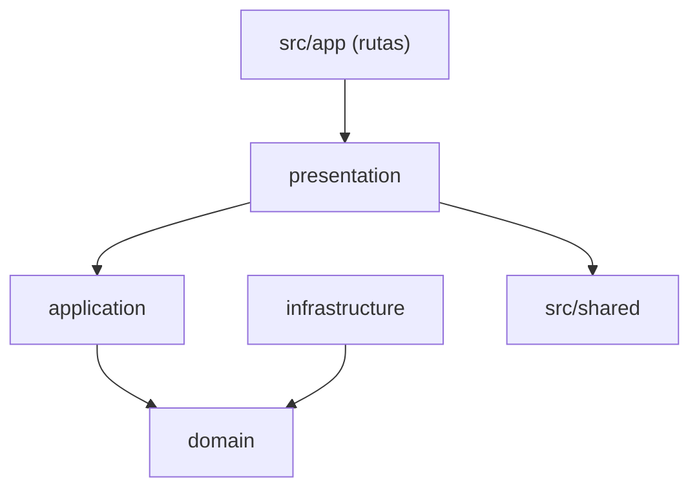

# Arquitectura de JobRadar ATS

Este documento distingue siempre entre lo **actual** (existe en el repositorio) y lo **planificado** (decisión tomada, aún sin implementar). Las reglas técnicas de Expo están en [AGENTS.md](../AGENTS.md) y no se repiten aquí.

## Decisión principal

**Arquitectura modular por funcionalidades con separación pragmática de capas.**

Cada funcionalidad del producto (ofertas, currículums, análisis, candidaturas…) será un módulo independiente. Dentro de cada módulo, el código se separa en capas conceptuales solo cuando hay contenido real para ellas.

## Estructura actual

Hoy el proyecto contiene la base técnica y los tokens del sistema de diseño (Fase 2a.1). **Todavía no existe ningún módulo de funcionalidad.**

```text
src/
  app/                  # Rutas de Expo Router
    _layout.tsx         # Stack provisional, tema de navegación e import de global.css
    index.tsx           # Pantalla de inicio provisional ("en construcción")
  shared/theme/         # Tokens del sistema de diseño (fuente única)
    colors.ts           # Paletas semánticas claro/oscuro
    typography.ts       # Escala tipográfica y familias de fuentes
    fonts.ts            # Carga de Sora y contexto de disponibilidad
    layout.ts           # Espaciado, radios y medidas de pantalla
    navigation.ts       # Temas de navegación derivados de las paletas
    index.ts            # Punto de entrada: @/shared/theme
  components/           # ThemedText y ThemedView (pendientes de migrar)
  constants/theme.ts    # Adaptador temporal que reexporta desde @/shared/theme
  hooks/                # useColorScheme (nativo y web) y useTheme
  global.css            # Variables CSS de fuentes para la web
__tests__/              # Pruebas (fuera de src/app)
jest/style-mock.js      # Sustituto de los imports de CSS en Jest
assets/                 # Iconos y pantalla de bienvenida
  fonts/                # Sora SemiBold y Bold (OTF) y su licencia OFL.txt
```

`components/`, `constants/` y `hooks/` son código heredado de la plantilla. Ya leen sus valores de `src/shared/theme/`, pero su migración definitiva a `src/shared/` (y la eliminación del adaptador) queda para una tarea posterior de la Fase 2.

## Estructura planificada

> **Planificado.** Salvo `src/shared/theme/`, ninguna de estas carpetas existe todavía y no se crearán vacías: cada una aparecerá cuando haya código que ponga en ella.

```text
src/
  app/                      # Rutas ligeras: componen pantallas, sin lógica de negocio
  features/
    <feature>/              # Un módulo por funcionalidad
      domain/               # Entidades, reglas de negocio y contratos
      application/          # Casos de uso y coordinación de operaciones
      infrastructure/       # Persistencia, APIs y servicios concretos
      presentation/         # Pantallas, hooks y componentes visuales
  shared/                   # Código genérico reutilizado, solo con necesidad real
```

Los nombres de las funcionalidades se fijarán al implementarlas. No todos los módulos necesitarán las cuatro capas: un módulo sencillo puede empezar solo con `presentation/` y `domain/`.

### Responsabilidades de cada capa

| Capa             | Contiene                                                                     | No debe contener                                   |
| ---------------- | ---------------------------------------------------------------------------- | -------------------------------------------------- |
| `domain`         | Entidades, reglas de negocio puras y contratos (interfaces) de repositorios  | React, React Native, Expo, acceso a red o disco    |
| `application`    | Casos de uso que coordinan el dominio a través de sus contratos              | Componentes visuales ni implementaciones concretas |
| `infrastructure` | Implementaciones concretas de los contratos: almacenamiento, APIs, servicios | Reglas de negocio                                  |
| `presentation`   | Pantallas, hooks y componentes visuales que usan los casos de uso            | Reglas de negocio ni acceso directo a persistencia |

### Reglas de dependencia



- El **dominio no depende de nada**: ni de otras capas ni de librerías de UI o plataforma. Así las reglas del motor ATS se pueden probar de forma aislada.
- `infrastructure` **implementa** los contratos definidos en `domain`. `application` depende de esos contratos, no de las implementaciones.
- Las rutas de `src/app/` solo importan pantallas de `presentation` y se mantienen ligeras.
- **Sin acoplamiento entre funcionalidades:** un módulo no importa el código interno de otro. Si algo debe compartirse, se mueve a `src/shared/` o se expone de forma explícita y mínima.
- `src/shared/` no depende de ninguna funcionalidad.

Estas reglas todavía no se aplican de forma automática. Se valorará reforzarlas con reglas de ESLint en la Fase 6.

## Decisiones técnicas tomadas

| Decisión                                                                      | Motivo                                                                                                                                              |
| ----------------------------------------------------------------------------- | --------------------------------------------------------------------------------------------------------------------------------------------------- |
| Expo Router con rutas en `src/app/`                                           | Navegación basada en archivos, común a iOS, Android y web.                                                                                          |
| Continuous Native Generation                                                  | `ios/` y `android/` se generan; la configuración nativa vive en `app.json` y en plugins de configuración.                                           |
| TypeScript `strict` y alias `@/*` → `src/*`                                   | Detectar errores pronto e importar sin rutas relativas largas.                                                                                      |
| Rutas tipadas y React Compiler (`app.json` → `experiments`)                   | Comprobación de tipos en la navegación y memoización automática. Ambas son experimentales (ver riesgos).                                            |
| `useColorScheme` web con `useSyncExternalStore`                               | Con `web.output: "server"`, el servidor renderiza en tema claro; el tema real se aplica tras la hidratación para evitar errores de hidratación.     |
| ESLint (`eslint-config-expo`) + Prettier, con `eslint-config-prettier`        | ESLint para errores y Prettier para el formato, sin reglas en conflicto.                                                                            |
| Finales de línea LF (`.gitattributes` y `.prettierrc`)                        | Evitar diferencias de CRLF/LF al desarrollar desde Windows.                                                                                         |
| Jest 30 + `jest-expo` + React Native Testing Library 14                       | Combinación indicada por la documentación de Expo SDK 58; `react-test-renderer` está obsoleto y no admite React 19.                                 |
| Tests en `__tests__/`, stub de CSS en `jest/style-mock.js`                    | Expo Router reserva `src/app/` para rutas, y Jest no puede interpretar el CSS que importa el layout raíz.                                           |
| `"types": ["jest"]` en `tsconfig.json`                                        | Hacer visibles a TypeScript los globales de Jest (`describe`, `it`, `expect`).                                                                      |
| Tokens de diseño en `src/shared/theme/`, sin librería de estilos              | Una sola fuente de verdad sin dependencias nuevas. Ningún color hexadecimal vive fuera de `colors.ts`.                                              |
| Paletas semánticas claro/oscuro seleccionadas con `useTheme()`                | Los componentes usan nombres de intención (`surface`, `accentText`), no colores. El esquema sale del `useColorScheme` seguro para hidratación.      |
| Contraste verificado por tests (`__tests__/theme-contrast.test.ts`)           | Texto ≥ 4,5:1 y controles ≥ 3:1 (WCAG 2.2 AA). Los bordes decorativos están exentos, pero no pueden ser la única señal visual.                      |
| Sin límite de escalado de texto (`maxFontSizeMultiplier`)                     | Priorizar maquetas flexibles. Cualquier límite futuro deberá justificarse en el componente concreto.                                                |
| `global.css` importado solo en `src/app/_layout.tsx`                          | Orden de carga correcto del CSS global, como indica Expo Router.                                                                                    |
| Adaptadores temporales (`constants/theme.ts`, variantes de ThemedText)        | Migrar por pasos sin romper los componentes existentes; reexportan o reutilizan los tokens, sin duplicar valores.                                   |
| Sora solo en títulos y cifras (`displaySteps`); sistema en el resto           | Personalidad en los titulares sin perder la legibilidad ni el escalado de la fuente del sistema. SemiBold 600 en títulos, Bold 700 en cifras.       |
| Sora como una familia con dos pesos, cargada con `useFonts` en el layout raíz | Patrón de Expo SDK 58. Llamado durante el render para que el servidor web incruste `@font-face` y `preload` en el HTML, sin errores de hidratación. |
| Sin bloqueo indefinido: se renderiza con `loaded` o con `error`               | El splash nativo se mantiene mientras carga. Si la carga falla, la app sigue con la fuente del sistema (`DisplayFontContext` en `false`).           |
| Respaldo web `Sora, system-ui, sans-serif` (sin variables CSS)                | En desarrollo el HTML del servidor no incluye `global.css`; una variable sin definir invalidaba la declaración y mostraba Times New Roman.          |

## Restricciones de producto que afectan al diseño

- **Puntuación explicable:** el futuro motor ATS debe devolver, junto a cada puntuación, los criterios aplicados y las evidencias encontradas en el CV y la oferta. Esta lógica pertenecerá a la capa `domain`.
- **Sin predicciones:** ningún texto ni cálculo debe presentar el resultado como la decisión que tomaría un ATS real.
- **Sin invención de datos:** las recomendaciones y la edición de CV no pueden añadir experiencia, titulaciones ni habilidades que el usuario no haya aportado.
- **Datos personales:** los CV contienen datos personales. Cualquier almacenamiento, envío a servicios externos o uso de IA deberá justificarse y evaluarse en términos de privacidad (RGPD) antes de implementarse.

## Riesgos técnicos conocidos

### Avisos de `npm audit`

Situación a 1 de noviembre de 2026: **46 avisos (45 moderados y 1 bajo, ninguno alto ni crítico)**. Todos proceden de tres paquetes transitivos:

| Paquete     | Gravedad | Aviso                                                                                                    | Llega a través de                            |
| ----------- | -------- | -------------------------------------------------------------------------------------------------------- | -------------------------------------------- |
| `glob`      | Moderada | [GHSA-3g3m-2fjr-6pw4](https://github.com/advisories/GHSA-3g3m-2fjr-6pw4) (versiones 9.0.0 a 14.0.1)      | Herramientas de Expo CLI y compilación, Jest |
| `minimatch` | Moderada | [GHSA-g3hv-75wg-m249](https://github.com/advisories/GHSA-g3hv-75wg-m249) (versiones anteriores a 11.0.1) | ESLint y sus plugins, `glob`, Jest           |
| `deepmerge` | Baja     | [GHSA-gcqx-w48m-w2h4](https://github.com/advisories/GHSA-gcqx-w48m-w2h4) (versiones 4.2.0 a 4.3.1)       | `jest-config` (solo pruebas)                 |

**Desarrollo y compilación frente a código ejecutado por el usuario.** npm cuenta 29 de los 46 avisos dentro de `dependencies`, pero esa clasificación no demuestra que el código vulnerable llegue a la app. Paquetes como `expo` o `expo-splash-screen` incluyen también herramientas de línea de comandos y plugins de configuración que solo se ejecutan en el equipo de desarrollo o durante la compilación. Indicios disponibles:

- `glob`, `minimatch` y `deepmerge` son utilidades de Node.js para el sistema de archivos y la configuración, propias de herramientas de desarrollo.
- En la compilación web (`npx expo export --platform web`) no aparece ninguna referencia por nombre a `minimatch`, `deepmerge` ni `glob`. Es un indicio, no una prueba: no se han analizado los bundles nativos de iOS y Android.

**Tratamiento pendiente:**

- No se ha aplicado ninguna corrección. `npm audit fix --force` propone bajar a `expo@51` y `eslint@4`, que es incompatible con el proyecto y no se debe ejecutar.
- Revisar de nuevo cuando Expo publique actualizaciones del SDK 58 (`npx expo install --fix`) y cuando ESLint y Jest actualicen esas dependencias.
- Revisar el aviso de `deepmerge`: npm indica que hay una corrección sin cambios incompatibles, pero no se ha comprobado qué actualizaría.
- Confirmar en la Fase 6 qué dependencias llegan a los bundles nativos.

### Otros riesgos

- **PWA y `web.output: "server"`.** La configuración actual genera una salida con servidor. Una PWA en un alojamiento gratuito suele requerir salida estática (`"static"`). Se estudiará en la fase de la PWA.
- **Pruebas en iOS desde Windows.** No hay simulador de iOS en Windows y la versión de Expo Go disponible en la App Store no es compatible directamente con Expo SDK 58. La estrategia actual es desarrollar con Expo Web, probar la interfaz desde Safari en el iPhone y preparar una PWA en la Fase 5b. Así no se verifica el comportamiento nativo en iOS. Instalar compilaciones de desarrollo en un iPhone propio con una cuenta gratuita de Apple requiere Xcode en un Mac, procedimiento que no se usará por ahora; TestFlight y la App Store requieren una membresía de pago, que no se contratará.
- **Funciones experimentales.** `typedRoutes` y `reactCompiler` están marcadas como experimentales en `app.json` y pueden cambiar entre versiones del SDK.
- **Destello de tema claro en web con modo oscuro.** El servidor renderiza siempre en claro y el tema real se aplica tras la hidratación. No hay errores de hidratación, pero en la primera carga quien usa el modo oscuro ve brevemente el tema claro (comprobado: el HTML del servidor solo contiene colores claros). Comportamiento previo a la Fase 2; su corrección (por ejemplo, fondo con `prefers-color-scheme` en `src/app/+html.tsx`) está pendiente de autorización.
- **Restos de la plantilla.** `ThemedView` acepta `lightColor` y `darkColor` pero no los usa. Se revisará al migrar los componentes a `src/shared/ui/`. (`BottomTabInset` se eliminó en la Fase 2a.1 porque nadie lo usaba.)
- **Sora en Android 9 y anteriores.** Cargada en tiempo de ejecución, Android por debajo de la API 29 solo registra una cara por familia, así que las cifras en Bold se verían en SemiBold. La solución es el plugin de configuración de `expo-font` en `app.json`, que solo funciona en compilaciones nativas.
- **Sora sin verificar en nativo.** La carga se ha comprobado en Expo Web (desarrollo y producción). En iOS y Android no se ha podido verificar por falta de un entorno nativo compatible con el SDK 58.
- **Palabras partidas con texto muy ampliado.** Con un zoom del 200 % a 390 px de ancho, «JobRadar» no cabe en una línea y se parte dentro de la palabra. No se recorta texto, pero conviene revisar los márgenes interiores cuando el texto es grande al crear `Screen` y `Card` en la Fase 2b.
- **Duplicado de `test-renderer`.** Conviven las versiones 1.3.0 (de `jest-expo`) y 1.3.1 (de React Native Testing Library). Hoy no causa fallos; vigilar si aparecen errores extraños en las pruebas.
- **Instalación en Windows.** `npx expo install <paquetes> "--" --dev` dejó los paquetes en `dependencies` en lugar de `devDependencies`. Hay que revisar `package.json` tras cada instalación.
- **Riesgos futuros.** La importación de PDF/DOCX y la IA local o gratuita dependerán de librerías que habrá que validar con Expo SDK 58, iOS, Android, la web y la privacidad de los datos.

## Cuestiones pendientes no técnicas

- **Licencia.** La licencia propia de JobRadar ATS está pendiente de decisión. El repositorio es privado. El archivo `LICENSE` actual es la licencia MIT de la plantilla de Expo (copyright de 650 Industries, Inc.) y se conserva sin modificaciones. Al elegir la licencia propia, deberán mantenerse los avisos y atribuciones de terceros que correspondan.
