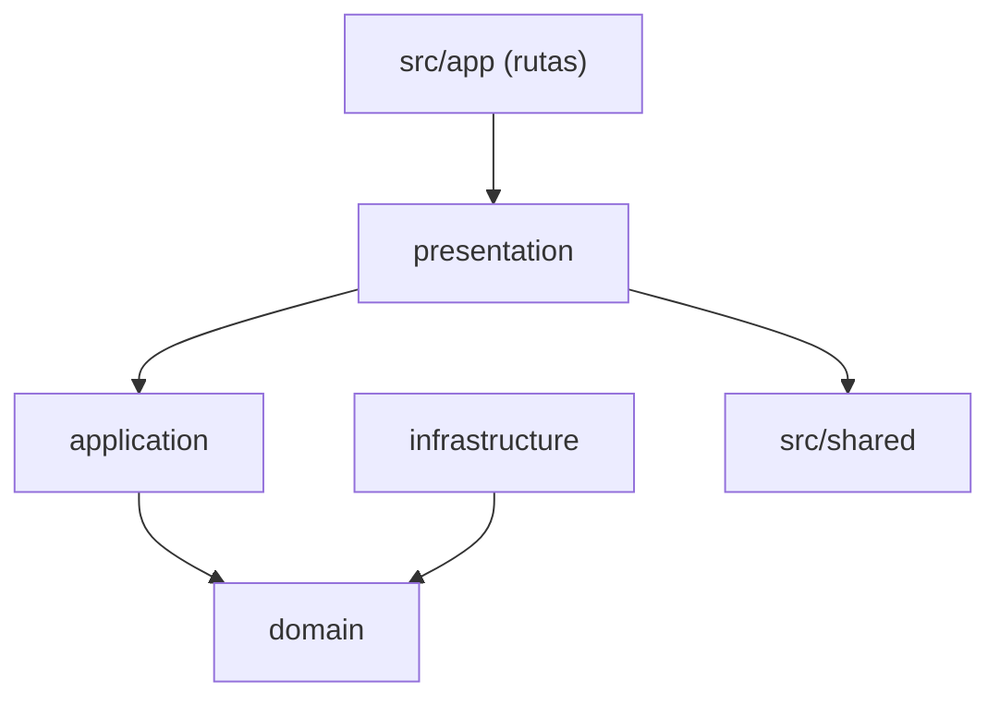

# Arquitectura de JobRadar ATS

Este documento distingue siempre entre lo **actual** (existe en el repositorio) y lo **planificado** (decisión tomada, aún sin implementar). Las reglas técnicas de Expo están en [AGENTS.md](../AGENTS.md) y no se repiten aquí.

## Decisión principal

**Arquitectura modular por funcionalidades con separación pragmática de capas.**

Cada funcionalidad del producto (ofertas, currículums, análisis, candidaturas…) será un módulo independiente. Dentro de cada módulo, el código se separa en capas conceptuales solo cuando hay contenido real para ellas.

## Estructura actual

Hoy el proyecto contiene la base técnica, el sistema de diseño de la Fase 2 (tokens y los componentes `Screen`, `Card`, `Icon`, `Button`, `TextField`, `ThemedText`, `Badge`, `Notice`, `EmptyState`, `Disclosure` y `SegmentedControl`) y los módulos de funcionalidad de la Fase A: `cv-match`, el analizador CV–oferta (capas `domain` y `presentation`), y `cv-import`, la importación de CV (las cuatro capas). El módulo `home` (Fase 4a.1, solo presentación) explica el producto y abre el analizador con «Analizar mi CV». Este tiene dos rutas, Preparar (`/analisis`) y Resultados (`/analisis/resultados`); la navegación global de la Fase 3 sigue pendiente (ver [roadmap.md](roadmap.md)).

```text
src/
  app/                  # Rutas de Expo Router
    _layout.tsx         # Stack provisional, tema de navegación e import de global.css
    index.tsx           # Monta HomeScreen y abre /analisis con Expo Router
    analisis/           # Analizador CV–oferta (Fase 3a.1)
      _layout.tsx       # Sesión compartida del analizador y pila de sus dos pantallas
      index.tsx         # Preparar: monta la pantalla con la vuelta al inicio y la apertura de Resultados
      resultados.tsx    # Resultados: monta la pantalla con la vuelta a Preparar
  features/
    home/presentation/  # Inicio: identidad, acción principal, pasos y metodología desplegable
    cv-match/           # Analizador CV–oferta (ver más abajo)
      domain/           # Motor en TypeScript puro
      presentation/     # Pantalla, hook de estado y componentes de resultados
    cv-import/          # Importación de CV en PDF y DOCX (ver más abajo)
      index.ts          # API pública y ensamblaje del módulo
      domain/           # Reglas en TypeScript puro
      application/      # Caso de uso: de un archivo elegido a un CV importado
      infrastructure/   # Selector de archivos y lectores reales (web) o no disponibles (nativo)
      presentation/     # Campo del CV, estado de la importación y mensajes
  shared/ui/            # Componentes genéricos del sistema de diseño
    screen.tsx          # Contenedor de pantalla: fondo, áreas seguras, márgenes, scroll
    card.tsx            # Contenedor de contenido sobre una superficie
    icon.tsx            # Iconos con catálogo multiplataforma (expo-symbols)
    button.tsx          # Botón principal y secundario con estados accesibles
    text-field.tsx      # Campo de texto de una o varias líneas con etiqueta, ayuda, error, contador y modo ampliado
    badge.tsx           # Insignia de estado: icono y texto con el tono semántico
    notice.tsx          # Aviso en recuadro: tono, icono, título opcional, mensaje y acciones
    empty-state.tsx     # Estado sin contenido: icono opcional, título, descripción y acción opcional
    disclosure.tsx      # Bloque plegable controlado: cabecera con aria-expanded y contenido
    focus-ring.ts       # Foco visible con teclado en web, compartido por Button, Disclosure y SegmentedControl
    segmented-control.tsx # Selector segmentado controlado: grupo de opciones con radiogroup y teclado
    themed-text.tsx     # Texto con la escala tipográfica y los colores del tema, y Heading
    web-text-style.d.ts # Tipo de `fieldSizing`, estilo web que React Native no declara
    web-pressable-props.d.ts # Tipo de `onKeyDown` en `Pressable`, que React Native Web admite
  shared/theme/         # Tokens del sistema de diseño (fuente única)
    colors.ts           # Paletas semánticas claro/oscuro
    typography.ts       # Escala tipográfica y pasos que usan Sora (displaySteps)
    fonts.ts            # Carga de Sora y contexto de disponibilidad
    layout.ts           # Espaciado, radios, tamaños de icono, área táctil y medidas de pantalla
    navigation.ts       # Temas de navegación derivados de las paletas
    index.ts            # Punto de entrada: @/shared/theme
  hooks/                # useColorScheme (nativo y web) y useTheme
  global.css            # Áreas seguras de Screen en web
__tests__/              # Pruebas (fuera de src/app)
jest/                   # Stubs y utilidades de prueba
  style-mock.js         # Sustituto de los imports de CSS en Jest
  cv-fixtures.ts        # PDF y DOCX ficticios generados en código, sin archivos binarios
  real-cv-readers.ts    # Lectores con pdf.js y mammoth reales para las pruebas de integración
  pdfjs-node.cjs        # Ejecuta pdf.js en un proceso de Node aparte (Jest no carga sus módulos ES)
  pdfjs-text-items.mjs  # Script de ese proceso: devuelve los fragmentos de texto de cada página
assets/                 # Iconos y pantalla de bienvenida
  fonts/                # Sora SemiBold y Bold (OTF) y su licencia OFL.txt
```

`hooks/` es código heredado de la plantilla. Ya lee sus valores de `src/shared/theme/`, pero su migración definitiva a `src/shared/` queda para una tarea posterior de la Fase 2. `ThemedView` se eliminó en la Fase 2b.1b (`Screen` lo sustituye). El `ThemedText` de la plantilla (`src/components/`) y el adaptador `src/constants/theme.ts` se eliminaron en la Fase A, cuando dejaron de tener consumidores: los sustituye `src/shared/ui/themed-text.tsx`. La exportación `Fonts` de `@/shared/theme`, que solo usaba aquel componente, y las variables de fuentes de `global.css` en las que se apoyaba en web se eliminaron en la Fase 1c de limpieza, porque ya no tenían consumidores y no formaban parte de la tipografía basada en Sora.

### Módulo `home` (Fase 4a.1)

`src/features/home/presentation/home-screen.tsx` contiene el Inicio. La ruta `/` solo lo monta y le pasa `onAnalyze`, que abre `/analisis` con Expo Router. No lee ni almacena la sesión del analizador.

- **Diseño.** Referencia: Inicio del prototipo aprobado, revisado en HTML y capturas. Marca JobRadar ATS en Sora, bloque marino con el mensaje principal (`h1`), acción «Analizar mi CV» y privacidad breve. Debajo, «Cómo funciona» y «Qué puedes esperar» (`h2`), con tres pasos numerados y los límites del producto. Se reutilizan `Screen`, `Card`, `Button`, `Icon`, `Heading`, `ThemedText` y `Disclosure`. El bloque de marca usa los colores existentes de la paleta oscura para mantener el contraste en ambos temas; no añade tokens ni componentes compartidos.
- **Responsive.** Hasta 1120 px incluidos los márgenes de `Screen`. Las filas flexibles se envuelven según el espacio disponible: en móvil, mensaje, acción, pasos y expectativas quedan en una columna; en escritorio, el mensaje y la acción se alinean, y las dos secciones inferiores comparten fila. No consulta dimensiones en JavaScript, duplica contenido ni añade CSS específico. Conserva el scroll, las áreas seguras y el ajuste de texto nativos.
- **Información funcional.** «Cómo se calcula la cobertura» abre un `Disclosure` con los criterios actuales, los requisitos no evaluables, el límite de los PDF escaneados y la duración de la sesión. El primer paso ofrece PDF/Word o texto en web; en iOS y Android indica texto pegado e importación pendiente. La privacidad distingue sesión en memoria de almacenamiento permanente. No hay historial, estadísticas, cuentas ni «Último análisis». La barra lateral y la navegación global permanecen fuera de esta subfase.
- **Verificación.** Se adaptan las pruebas existentes de Inicio, navegación, Sora y temas, y se añade una para abrir y cerrar la metodología. Playwright comprueba 390 y 1440 px, claro/oscuro, navegación real, teclado y foco, controles de al menos 44 × 44 px, contraste del texto y ausencia de errores de consola y desbordamiento. Se comprueba también el ajuste a 320, 768 y 1024 px; las capturas representativas se guardan fuera del repositorio. Safari y lectores de pantalla en dispositivos siguen pendientes.

### `ThemedText` y `Heading`

Único componente compartido de texto, con la interfaz basada en los tokens: `step` es un paso de la escala tipográfica (`body` por defecto) y `color`, un color del tema (`text` por defecto). Los pasos de `displaySteps` usan Sora cuando ha cargado. El `style` de quien lo usa se aplica el último.

`Heading` es un `ThemedText` con `accessibilityRole="header"` y `aria-level`: en web se convierte en `<h2>` o `<h3>`. El nivel 2 usa el paso `heading` (Sora) y el nivel 3, `headline`. El título de cada pantalla es un `ThemedText` de paso `title` con `accessibilityRole="header"`, que en web es el `<h1>`.

### Módulo `cv-match` (Fase A)

Compara el texto de un CV con el de una oferta, requisito por requisito. Tiene las capas `domain` y `presentation`.

#### Dominio

```text
src/features/cv-match/domain/
  analyze-match.ts       # Punto de entrada: analyzeMatch(cvText, offerText)
  offer-requirements.ts  # Requisitos de la oferta, con su importancia y sus frases de origen
  cv-structure.ts        # Secciones y frases del CV, y comprobaciones básicas (contacto, cifras)
  assess.ts              # Estado y evidencias de cada requisito
  coverage.ts            # Puntos y cobertura
  recommendations.ts     # Recomendaciones a partir del resultado
  compare.ts             # Cambios entre dos análisis
  criteria.ts            # Niveles de estudios, niveles de idioma (MCER) y años
  skill-catalog.ts       # Catálogo cerrado de habilidades, conocimientos e idiomas
  text.ts                # Normalización, líneas, frases y búsqueda de términos
  input.ts               # Campos que deben rellenarse antes de analizar
  types.ts               # Tipos del resultado
```

- **TypeScript puro.** Solo importa sus propios archivos. No depende de React, React Native, Expo, red, disco ni otros módulos, y no usa globales de plataforma. Se prueba en Jest sin renderizar nada (`__tests__/cv-match-*.test.ts`). Se ejecuta en el dispositivo y no guarda nada.
- **Requisitos.** De la oferta extrae conceptos del catálogo, idiomas con nivel, estudios mínimos y años de experiencia. Cada requisito conserva las frases literales de las que sale y su importancia (obligatorio, deseable, sin clasificar o ambigua). Las líneas que no reconoce se muestran como no evaluables.
- **Evidencias textuales.** Cada requisito queda respaldado (una frase de experiencia o proyectos describe su uso), mencionado (se nombra sin describir el uso), no acreditado o no evaluable. Siempre lleva el motivo en lenguaje claro y, cuando las hay, las frases literales del CV en que se basa. El conocimiento teórico, el aprendizaje en curso y las negaciones («Docker: sin experiencia») nunca cuentan como respaldo.
- **Cobertura explicable.** 1 punto por requisito respaldado, 0,5 por mencionado y 0 por no acreditado; los obligatorios pesan el doble. El porcentaje es la parte de los puntos posibles y se entrega con los puntos y los recuentos por estado. Los requisitos no evaluables no cuentan; si no se puede evaluar ninguno, no hay porcentaje.
- **Recomendaciones.** Se construyen con textos fijos y etiquetas de la oferta, nunca con contenido del CV, y no sugieren añadir experiencia, titulaciones ni habilidades que el usuario no tenga.

Limitaciones:

- **Motor heurístico.** Reglas y un catálogo cerrado escritos para JobRadar, sin IA. Lo que no está en el catálogo se marca como no evaluable en lugar de adivinarse.
- **Sin predicciones.** La cobertura mide los requisitos detectados en la oferta. No es la decisión de ningún ATS real ni una probabilidad de contratación.
- **Español.** Las reglas de importancia, negación y matización están escritas para textos en español; algunos encabezados del CV se reconocen también en inglés.
- **Solo texto.** Analiza texto ya escrito o pegado; no lee archivos (eso lo hace `cv-import`).

#### Presentación

```text
src/features/cv-match/presentation/
  cv-match-screen.tsx      # Preparar: CV, oferta, «Analizar», avisos y estado del último análisis
  results-screen.tsx       # Resultados: título, aviso de desactualización, resultados o estado vacío
  analysis-session.tsx     # Sesión compartida por Preparar y Resultados, solo en memoria
  cv-section.tsx           # Sección «Tu CV»: selector Archivo / Pegar texto y campo de cada modalidad
  offer-section.tsx        # Sección «La oferta»: texto de la oferta, estado y editor ampliable
  use-cv-match.ts          # Estado del análisis: validación, resultado, comparación y desactualización
  analysis-results.tsx     # Bloque de resultados: resumen, cambios, qué mejorar primero y requisitos por estado
  results-layout.tsx      # Una columna en nativo; la variante .web.tsx y su CSS distribuyen Resultados
  filter-chips.tsx         # Filtros visuales por estado, con recuentos y selección única; solo del analizador
  coverage-summary.tsx     # Resumen compacto: cobertura, barra, recuentos y aclaración ATS; el cálculo, plegado
  coverage-bar.tsx         # Puntos posibles y aportados por estado en una barra segmentada
  requirement-item.tsx     # Un requisito como fila desplegable: resumen a la vista; motivo y evidencias al abrir
  status-badge.tsx         # Estado con icono y texto, nunca solo color
  analysis-changes.tsx     # Cambios respecto al análisis anterior: cobertura visible y lista plegada
  recommendation-list.tsx  # «Qué mejorar primero»: tres recomendaciones y «Ver todas»
  labels.ts                # Textos de estados, importancia, secciones y formatos de números
  sample-texts.ts          # CV y oferta ficticios para la demostración
```

- **Flujo.** En «Tu CV», un `SegmentedControl` elige la modalidad: «Archivo» (PDF o DOCX, la inicial en web) o «Pegar texto». La oferta se pega completa. «Analizar» valida que haya texto en ambos; si falta algo, se queda en Preparar y mueve el foco al primer campo que falte. Si el análisis se hace, abre Resultados (Fase 3a.1), con la cobertura, los requisitos agrupados por estado con sus evidencias y las recomendaciones.
- **Resultados desactualizados.** Si cambia el CV o la oferta tras analizar, los resultados siguen visibles con un aviso hasta volver a analizar. Si se sustituye el CV por otro documento, los resultados anteriores se ocultan. El nuevo análisis se compara con el anterior solo si la oferta es la misma.
- **Dos modalidades sin pérdidas (Fase 3b.1).** El documento importado vive en `useCvImport` y el texto pegado en la pantalla, así que cambiar de modalidad no borra ninguno: solo decide cuál se analiza. Si la modalidad no elegida también tiene contenido, un aviso informativo lo dice («… se conserva en «Archivo». Con «Pegar texto» elegido, se analizará el texto pegado»). Como cada modalidad es un CV distinto (`sourceKey`), cambiar de una a otra oculta los resultados anteriores con el aviso «Has cambiado de CV». En la app nativa no se muestra el selector: solo hay texto pegado, con su aviso de importación pendiente.
- **Sección «La oferta» (Fase 3b.2).** Título «La oferta» (`h2`) y un `TextField` multilínea, «Texto de la oferta», con la ayuda «Pega la oferta completa, sin recortarla.» y el error de validación debajo. Con texto, una línea indica «Lista para analizar» y el número de caracteres; no es una región en vivo, porque cambiaría con cada pulsación. El botón «Ampliar el editor» / «Reducir el editor» cambia solo la altura visible: de hasta 12 líneas a hasta 28, sin pasar del 75 % de la ventana. Su etiqueta indica el estado, así que no necesita `aria-pressed`. El texto vive en `useCvMatch` y la sección solo guarda si el editor está ampliado: ampliar, reducir o cambiar la modalidad del CV no lo altera ni marca los resultados como desactualizados. Editarlo, sí. Escribir no analiza nada: el análisis sigue empezando con «Analizar». No se añaden campos de empresa, puesto ni ubicación porque el motor solo recibe el texto.
- **Preparar y Resultados (Fase 3a.1).** `AnalysisSessionProvider` (en `analysis-session.tsx`) reúne `useCvImport`, la modalidad, el texto pegado y `useCvMatch` sin duplicar su lógica, y lo monta el layout de `/analisis`. Las dos pantallas lo leen con `useAnalysisSession`.
  - **Navegación.** Un análisis correcto abre Resultados con `router.push`, así Atrás vuelve a Preparar. «Editar CV u oferta» usa `router.dismissTo('/analisis')`: retrocede si Preparar está en la pila y la sustituye si Resultados se abrió directamente. Las pantallas reciben la navegación de la ruta (`onShowResults`, `onEdit`), así `cv-match` no depende de Expo Router.
  - **Preparar.** Muestra el estado del último análisis y «Ver resultados» mientras sigue correspondiendo a los datos. Si cambian, desaparece y quedan los avisos de cambio, como antes.
  - **Resultados.** Empieza por su título (`h1`), al que va el foco en web. Si los datos cambiaron, muestra un aviso con «Volver a analizar»; si falta algo para analizar, vuelve a Preparar. Sin análisis en la sesión (dirección directa o recarga), muestra `EmptyState` con «Preparar análisis». Si el CV es otro, muestra el estado «Has cambiado de CV» con «Volver a analizar».
- **En memoria.** Los textos y resultados no se guardan ni se envían: viven en la sesión del analizador, que se conserva al ir y volver entre Preparar y Resultados, con Atrás y Adelante, y se pierde al salir del analizador, recargar o cerrar la app. Nunca van a la dirección (URL), al almacenamiento del navegador o del dispositivo, a los registros ni a ningún servicio.
- **Demostración solo en desarrollo.** «Cargar ejemplo ficticio» aparece únicamente con `__DEV__`, separado y debajo de «Analizar», y marcado como demostración. No llega a la compilación publicada.
- **Vuelta al inicio provisional.** La pantalla recibe `onGoHome` de la ruta, que vuelve atrás o, si se abrió directamente, sustituye la ruta por la de inicio. Así `cv-match` no depende de Expo Router.
- **Componentes compartidos.** El indicador de estado delega en `Badge` y los avisos usan `Notice` (Fase 2c.2a). Si la oferta no tiene requisitos reconocibles, Resultados muestra un `EmptyState` sin acción en el lugar de los grupos de requisitos, con un título `h3` como ellos (Fase 2c.2b).
- **Barra de cobertura.** `CoverageBar` vive en la presentación de `cv-match`, porque conoce los estados del analizador. Recibe las evaluaciones y agrega exclusivamente los valores de `contribution` ya calculados por el dominio: no decide pesos, aportaciones ni porcentaje. `CoverageSummary` conserva el porcentaje, los recuentos y la explicación anteriores, y omite la barra cuando no hay requisitos evaluables.
- **Resultados, primera pantalla (Fase 3c.1).** Orden: título (`h1`), resumen compacto, comparación (si existe), «Qué mejorar primero» (`h2`) y «Requisitos de la oferta» (`h2`, con sus grupos `h3`). Se quitó el `h2` «Resultados», redundante con el título. El resumen mantiene porcentaje, puntos, barra, recuentos y «No es una puntuación ATS ni una probabilidad de contratación»; la explicación del cálculo está en un `Disclosure` («Cómo se calcula la cobertura»). La comparación muestra la variación de cobertura y pliega la lista de requisitos cambiados. Las recomendaciones llegan ordenadas por el motor: se muestran las tres primeras y «Ver todas (N)» añade el resto sin repetir ninguna; los mensajes idénticos se muestran una vez. No se recalcula nada. Medición con datos ficticios en 390 × 844 px: la primera recomendación empieza a 635 px y cabe entera (110 px); con comparación empieza a 799 px y se ven 45 px de ella.
- **Requisitos desplegables (Fase 3c.2a, `b0ae88b`).** Cada requisito es un `Disclosure` contraído por defecto, con estado propio: varios pueden estar abiertos a la vez. La cabecera muestra el nombre, la insignia de estado y «importancia · puntos que aporta» (sin repetir el estado en texto). Al abrirse aparecen el motivo completo, las evidencias literales del CV (las tres primeras y «Y N frases más», como antes) y las frases de la oferta: no se pierde información. Como la cabecera es una vista personalizada, el `Disclosure` exige un nombre accesible: «Nombre. Estado. Importancia · puntos», que sustituye la lectura de sus partes; la cabecera no contiene controles anidados. El contenido plegado no se monta, así que no está en el árbol accesible ni en la tabulación. Orden, categorías y datos del motor no cambian. Medición con datos ficticios (13 requisitos): lista contraída de 2.343 px a 390 px de ancho y de 1.953 px a 1440 px, frente a 5.341 y 4.203 px con todos abiertos, que es aproximadamente la altura anterior.
- **Filtros de requisitos (Fase 3c.2b, `1ea613c`).** Debajo de «Requisitos de la oferta», `FilterChips` ofrece «Todos», «No acreditados», «Sin evidencia suficiente» y «Respaldados». `AnalysisResults` guarda una única selección local, inicialmente «Todos», y deriva los recuentos de `result.requirements`, sin usar ni alterar la cobertura. «Todos» cuenta también los no evaluables; los otros tres recuentos incluyen solo su estado. Los no evaluables permanecen visibles con cualquier filtro en su grupo «No evaluables, fuera del porcentaje», sin sumarse al recuento del estado seleccionado. El filtrado conserva los grupos y el orden original dentro de cada grupo; cobertura, comparación y recomendaciones reciben siempre los datos completos. No cambia el motor ni la sesión compartida.
  - **Desplegables al filtrar.** Un requisito que permanece visible conserva su apertura. Si deja de mostrarse se desmonta, y vuelve contraído al reaparecer: no se guarda un mapa adicional de aperturas. Su motivo y evidencias originales vuelven a estar disponibles al abrirlo. El grupo no evaluable mantiene su apertura porque nunca se oculta.
  - **Accesibilidad y disposición.** Botones con `aria-pressed` en web y `accessibilityState.selected` en nativo, etiqueta y recuento accesibles, marca de selección además del color, anillo de foco y objetivos de al menos 44 × 44 px. Tab recorre las opciones; Intro y Espacio las activan. Se distribuyen en varias líneas sin desplazamiento horizontal; se reserva el espacio de la marca para evitar que cambien de tamaño al seleccionar. No se fuerza desplazamiento al filtrar. Si no hay requisitos del estado elegido, `EmptyState` ofrece «Ver todos los requisitos» y devuelve el foco a «Todos» en web; los no evaluables siguen debajo. Verificado con Playwright en Chromium a 390 y 1440 px, claro y oscuro, con datos ficticios y capturas fuera del repositorio. VoiceOver y TalkBack en dispositivos siguen pendientes.

- **Resultados responsive (Fase 3d.1, `463aa50`).** `ResultsPage` conserva la cabecera, la acción «Editar CV u oferta» y los avisos por encima del análisis. `ResultsColumns` recibe un único bloque de resumen (cobertura, comparación y recomendaciones) y otro de requisitos (título, filtros, grupos y evidencias). Su variante web importa `results-layout.css`: desde 1024 px usa una rejilla con proporción 2:3, separación `space[6]` y hasta 1240 px útiles (1280 px con los márgenes de `Screen`); por debajo conserva la columna, el orden y la anchura anterior de 800 px incluidos los márgenes. Cada columna permite encoger su contenido sin desbordar. La versión nativa mantiene una columna con los mismos espaciados.
  - **Renderizado y estados.** Se reutiliza el patrón web de `Screen`: un contenedor HTML para CSS y tokens de TypeScript como variables. La hoja se importa solo desde `.web.tsx`; no se consultan dimensiones ni se usan efectos para decidir el diseño. El servidor y el cliente montan el mismo árbol. Cambiar el tamaño solo cambia CSS: no duplica ni desmonta el análisis, ni reinicia filtros, requisitos, comparación o recomendaciones. La lectura y tabulación siguen el orden del contenido: resumen y recomendaciones antes de requisitos. Se mantienen las áreas seguras y el desplazamiento único de `Screen`.
  - **Panel izquierdo sin sticky.** La comparación y las recomendaciones expandidas pueden superar la altura de la ventana. Se conserva el desplazamiento natural de la página para que todo el panel siga accesible con teclado y zoom, sin introducir un segundo desplazamiento ni limitar su altura.
  - **Validación.** Las 682 pruebas existentes conservan su cobertura; las pruebas dirigidas de resumen, filtros y pantalla protegen los comportamientos reutilizados. Playwright comprueba la maquetación real y la conservación de estados al redimensionar en una sesión, a 390, 768, 1023, 1024 y 1440 px, en claro y oscuro, con y sin comparación, requisitos y recomendaciones expandidos, teclado y ausencia de solapamientos, desplazamiento horizontal y errores de hidratación. Solo se guardan capturas representativas fuera del repositorio. La comprobación en Safari y en dispositivos nativos sigue pendiente.

### Módulo `cv-import` (Fase A)

Obtiene el texto de un CV en PDF o DOCX para analizarlo. Tiene las cuatro capas, y otros módulos solo lo usan a través de su API pública, `src/features/cv-import/index.ts`.

#### Dominio

```text
src/features/cv-import/domain/
  detect-format.ts             # Formato por el contenido del archivo, no por su nombre
  assemble-pdf-text.ts         # Reconstrucción de líneas a partir de los fragmentos de texto de un PDF
  docx-html-to-text.ts         # Texto plano a partir del HTML sencillo que genera mammoth
  normalize-extracted-text.ts  # Normalización de caracteres y líneas, con recuento de cambios
  characters.ts                # Letras y caracteres ilegibles
  assess-extraction.ts         # Evaluación de la calidad de la extracción
  imported-cv.ts               # CV importado, correcciones del usuario y texto que se analiza
  readers.ts                   # Contrato de los lectores, que implementará cada plataforma
  types.ts                     # Tipos de formatos, fallos, avisos y estados
```

- **TypeScript puro.** Mismas condiciones que `cv-match`: solo importa sus propios archivos, sin React, Expo, red, disco, globales de plataforma ni otros módulos. Las librerías de lectura quedan detrás del contrato `CvReaders` de `readers.ts`. Se prueba en Jest (`__tests__/cv-import-*.test.ts`).
- **Identificación de formatos.** Por las firmas de su contenido: PDF, DOCX (un ZIP con `word/document.xml`), Word antiguo o protegido con contraseña, RTF y archivos vacíos. El nombre del archivo solo sirve para avisar si no coincide.
- **Normalización de texto.** Unifica saltos de línea, ligaduras, guiones suaves, caracteres invisibles, espacios especiales y líneas en blanco. Nunca elimina palabras, une líneas cortadas con guion ni recorta, y cuenta cada cambio.
- **Reconstrucción de líneas PDF.** Agrupa en líneas los fragmentos de texto con posición de cada página, con umbrales proporcionales al tamaño de letra. Conserva todo el texto y marca las páginas cuyo orden de lectura puede ser incorrecto, como en los diseños de varias columnas.
- **Texto de DOCX.** Convierte el HTML de mammoth en texto plano como una cadena: nunca se interpreta en un navegador, se inserta en la interfaz ni se ejecuta.
- **Evaluación de la extracción.** Distingue errores demostrados, que bloquean el análisis (sin texto, por ejemplo un PDF escaneado, o con un 30 % o más de caracteres ilegibles), avisos que piden revisar el texto (caracteres ilegibles, páginas sin texto, orden de lectura) y notas inciertas que solo se muestran (poco texto). Los umbrales son configurables y se tratan como criterios, no como certezas.
- **Gestión de correcciones.** El texto extraído no se modifica: la corrección del usuario se guarda aparte, se puede descartar y, si existe, es la que se analiza. Una corrección permite analizar un texto bloqueado, porque lo ha escrito el usuario.

#### Aplicación e infraestructura

```text
src/features/cv-import/
  application/import-cv.ts        # importCvFile: tamaño, formato, lectura y confirmación
  infrastructure/
    pick-cv-file.web.ts           # Selector del navegador con expo-document-picker
    pick-cv-file.ts               # Nativo: «no disponible», sin abrir ningún selector
    pdf-reader.web.ts             # Lector de PDF con pdf.js (compilación legacy)
    pdf-reader.ts                 # Nativo: no disponible
    docx-reader.web.ts            # Lector de DOCX con mammoth
    docx-reader.ts                # Nativo: no disponible
    cv-readers.ts                 # Lectores de la plataforma actual
    pdfjs-worker.d.ts             # Tipo del módulo del worker de pdf.js, que no trae declaraciones
```

Metro elige los archivos `.web.ts` en web y los `.ts` en iOS y Android. Por eso pdf.js y mammoth no deberían entrar en las compilaciones nativas, aunque no se ha comprobado con una compilación nativa real.

| Plataforma    | Elegir archivo                                                         | PDF                                     | DOCX                             |
| ------------- | ---------------------------------------------------------------------- | --------------------------------------- | -------------------------------- |
| Web           | `expo-document-picker` (selector del navegador), solo `.pdf` y `.docx` | pdf.js 6.4.299 (`legacy`), en el equipo | mammoth 1.13.0, en el equipo     |
| iOS y Android | **No implementado.** Devuelve «no disponible» sin abrir el selector    | No disponible (error de lectura)        | No disponible (error de lectura) |

- **Extracción local.** El archivo se lee en el navegador desde su `File`, sin copia en base64, y el texto se extrae en el propio equipo. Ningún documento se envía a un servidor.
- **Carga diferida.** pdf.js, su worker y mammoth se cargan con `import()` la primera vez que se abre un PDF o un DOCX, y pdf.js solo una vez. Metro los separa en fragmentos propios, así que no pesan en la carga inicial. Mientras ninguna pantalla use la importación, no forman parte de la compilación web.
- **pdf.js `legacy`.** Esta compilación incluye compatibilidad con API recientes (`Math.sumPrecise`, `URL.parse`) para Safari antiguos. El código del worker se ejecuta en el hilo principal: no se sirve ningún archivo de worker ni se fija `workerSrc`, así que nunca se carga código de otro origen.
- **Sin peticiones de pdf.js.** Se abre con los bytes del archivo y sin ninguna URL de recursos (mapas de caracteres, fuentes estándar, perfiles de color, WebAssembly): `disableAutoFetch`, `disableStream`, `disableRange`, `useWorkerFetch: false`, `useWasm: false`, `useSystemFonts: false`. Solo registra errores.
- **Sin contenido activo.** Solo se pide el texto de cada página (`getTextContent`): no se dibujan páginas ni se usa la capa de anotaciones, XFA está desactivado y no se carga el entorno de scripts de pdf.js. En la versión 6.4.299, los módulos que se cargan no contienen `eval` ni `new Function`; la vulnerabilidad GHSA-hq66 está corregida desde la 6.2.108.
- **DOCX sin HTML en la interfaz.** mammoth convierte el documento en HTML, que se transforma en texto como una cadena. Nunca se interpreta, se inserta en la interfaz ni se ejecuta. Las imágenes no se convierten ni se copian en el HTML.
- **Límites provisionales.** Los archivos de más de **10 MB** se rechazan sin leerlos, tanto por el tamaño que declara el navegador como por los bytes leídos. Un PDF de **más de 20 páginas** pide confirmación antes de leer su texto; si se confirma, se leen todas las páginas, y si se cancela, se cierra sin leerlo. Nada se recorta.
- **Fallos controlados.** Formato no admitido o vacío, Word antiguo o protegido, PDF con contraseña, archivo dañado y error de lectura dan un CV importado fallido con su motivo, no una excepción.

Pruebas:

- **Sin navegador.** `__tests__/cv-import-application.test.ts` y `cv-import-adapters.test.ts` prueban el caso de uso y los adaptadores con dobles de prueba, incluidas las opciones de pdf.js y el comportamiento nativo.
- **Lectores reales.** `cv-import-integration.test.ts` usa mammoth y pdf.js reales con PDF y DOCX ficticios generados en `jest/cv-fixtures.ts`. Jest no carga los módulos ES de pdf.js, por lo que pdf.js se ejecuta en un proceso de Node aparte (`jest/pdfjs-node.cjs`).

Limitaciones:

- **Sin importación nativa.** iOS y Android no pueden elegir ni leer archivos: pdf.js no funciona en Hermes y mammoth no se ha probado allí.
- **Sin OCR.** Un PDF escaneado o hecho de imágenes se bloquea con un aviso de posible escaneo, y se pide pegar el texto.
- **Documentos protegidos.** Los PDF con contraseña y los Word protegidos o antiguos (`.doc`) no se leen: se pide guardarlos sin contraseña, como PDF o como `.docx`.
- **Diseños complejos.** En los PDF con varias columnas, el orden de lectura puede ser incorrecto y se pide revisarlo. En los DOCX se pierden los encabezados y pies de página.

#### Presentación y API pública

```text
src/features/cv-import/
  index.ts                      # API pública: CvFileField, useCvImport y el tipo CvImport
  presentation/
    use-cv-import.ts            # useCvImportWith: estado de la importación con dependencias inyectadas
    cv-file-field.tsx           # Modalidad «Archivo»: zona para elegir, tarjeta, avisos y texto plegable
    file-card.tsx               # Tarjeta del archivo: nombre, datos reales, estado y «Cambiar archivo»
    messages.ts                 # Mensajes de fallos y avisos de extracción
```

- **Inyección de dependencias.** El hook de presentación (`useCvImportWith`) recibe `canPickFile`, `pickFile` y `readers`, y nunca importa la infraestructura. `index.ts` es el punto de composición: une el selector y los lectores de la plataforma y expone `useCvImport()` ya ensamblado.
- **Dependencias entre módulos.** `cv-match` solo importa `@/features/cv-import`, y `cv-import` no importa nada de `cv-match`. No hay dependencias circulares (comprobado con un análisis de importaciones de `src/`).
- **Sin archivo (Fase 3b.1).** Una zona con borde discontinuo ofrece «Seleccionar PDF o Word» con los formatos, el límite de 10 MB y la nota de privacidad. Con el error de validación del CV, el borde pasa a `danger` y el error va debajo.
- **`FileCard` (Fase 3b.1).** Tarjeta del documento con el nombre (dos líneas como máximo), los datos que la importación conoce de verdad (formato, páginas y caracteres extraídos, y nada más), una `Badge` con el estado (`Texto extraído`, `Revisa el texto`, `Sin texto que analizar` o `No se ha podido leer`), una línea si el texto se ha corregido y «Cambiar archivo». Mientras se lee, solo muestra el nombre y «Leyendo en este dispositivo…», con el botón ocupado. El icono del documento usa el tono de acento, o `danger` si el archivo no se pudo leer o no tiene texto. Con poco ancho, el botón pasa debajo de los datos.
- **Avisos del documento.** Cada aviso de extracción es un `Notice` de su tono bajo la tarjeta. Los errores (archivo ilegible, PDF sin texto) llevan la acción «Pegar texto en su lugar», que cambia de modalidad. Las confirmaciones (PDF de más de 20 páginas) y los rechazos (más de 10 MB) se muestran en el mismo sitio. Una región en vivo educada, siempre montada, anuncia la tarjeta y los avisos.
- **Revisión del texto (Fase 3b.1).** El texto extraído se revisa y corrige dentro de un `Disclosure` («Revisar el texto extraído»): plegado tras una lectura correcta y abierto si hay avisos que revisar. La decisión del usuario se recuerda para ese documento y vuelve al estado inicial con un archivo nuevo. Como `Disclosure` desmonta su contenido, el texto y la corrección viven en `useCvImport`: plegar, desplegar o cambiar de modalidad no los pierde. Un CV sin texto también conserva la revisión, para escribirlo allí.
- **Elegir o sustituir.** Si se cancela el selector o la confirmación de un PDF largo, se conserva el CV anterior. Un archivo rechazado o que no se puede leer sí sustituye al anterior. Antes de la hidratación, «Seleccionar PDF o Word» aparece desactivado, porque aún no respondería.
- **App nativa.** Como `canPickFile` es `false`, la pantalla empieza con el CV pegado y explica que importar un PDF o un Word todavía no está disponible en la app para iOS y Android.

#### Verificación en navegador

Comprobado en Chrome de escritorio con Playwright, sobre el servidor de desarrollo de este proyecto, a 390 y 1440 px y en modo claro y oscuro:

- PDF y DOCX ficticios importados y analizados; la estructura del texto se conserva.
- PDF a dos columnas con aviso de orden, PDF escaneado bloqueado, PDF dañado, Word antiguo y archivo de 11 MB rechazado.
- Confirmación del PDF de 25 páginas: al cancelar se conserva el CV anterior, y al confirmar se leen las 25 páginas. Al cancelar el selector también se conserva el CV.
- Edición, aviso de resultados desactualizados, comparación con el análisis anterior, restauración y sustitución del CV.
- Navegación por teclado con foco visible, encabezados `h1` → `h2` → `h3` sin saltos, vuelta al inicio (también abriendo `/analisis` directamente) y botones atrás y adelante del navegador.
- Sin desplazamiento horizontal.
- Sin errores en la consola durante el recorrido.
- Todo el tráfico va al propio servidor: pdf.js, su worker y mammoth se descargan en fragmentos propios solo al elegir un PDF o un DOCX. En la compilación de producción, pdf.js ocupa dos fragmentos (0,6 y 1,3 MB), mammoth otro (313 KB) y la ruta `/analisis`, 87 KB.
- Las dos rutas se renderizan en el servidor sin errores.

**Pendiente:** Safari en iPhone y otros navegadores (Firefox, Safari de escritorio), lectores de pantalla reales y documentos reales distintos de los ficticios.

La Fase 3b.1 repitió el recorrido de «Tu CV» en Chrome con Playwright, a 390 y 1440 px y en claro y oscuro:

- Selector con `role="radiogroup"` y nombre, opciones `role="radio"` con `aria-checked` y 44 px de alto.
- Solo la opción elegida en el orden de tabulación (`tabindex` 0 y -1); flechas, Inicio y Fin cambian la selección y el foco, y el anillo de foco es visible.
- Tarjeta con datos reales; revisión plegada y abierta; corrección conservada al plegar y al cambiar de modalidad; aviso de contenido conservado.
- PDF escaneado, PDF a dos columnas, confirmación del PDF largo y archivo de más de 10 MB.
- Sin desplazamiento horizontal, sin controles de menos de 44 px y sin errores de consola.

La Fase 3b.2 hizo lo mismo con «La oferta», a 390 y 1440 px y en claro y oscuro:

- Oferta vacía (170 px), con error de validación (`aria-invalid` y `aria-describedby` hacia el error y la ayuda) y extensa (4.972 caracteres): 314 px con desplazamiento interno.
- Editor ampliado a 633 px en una ventana de 844 px y a 675 px en una de 900 px (el 75 % de la ventana). Al ampliar, al reducir y al analizar, el texto sigue idéntico.
- Botón alcanzable con Tab desde el campo, con anillo de foco, y activable con Intro y Espacio; su etiqueta cambia y el foco se queda en él.
- Encabezados `h1` → `h2` («Tu CV», «La oferta»), sin desplazamiento horizontal, sin controles de menos de 44 px y sin errores de consola.
- **No verificado:** el desplazamiento con la rueda dentro del campo. La rueda simulada por Playwright no movió ni el campo ni la página, ni siquiera con el puntero sobre el campo, así que queda para una revisión manual.

La Fase 3a.1 recorrió en Chrome con Playwright, a 390 y 1440 px y en claro y oscuro, el flujo entre las dos pantallas:

- Un análisis sin datos se queda en `/analisis`; uno correcto abre `/analisis/resultados`, sin datos en la dirección, con el foco en «Resultados del análisis».
- «Editar CV u oferta» vuelve con la modalidad, el CV, la oferta, el archivo, su corrección y la revisión abierta tal como estaban.
- «Ver resultados», Atrás y Adelante del navegador conservan los datos y los resultados.
- Al recargar Resultados aparece «Todavía no hay resultados», sin nada en `localStorage` ni `sessionStorage`, y «Preparar análisis» abre un formulario vacío. «Volver al inicio» sigue funcionando.
- Sin desplazamiento horizontal, sin controles de menos de 44 px y sin errores ni avisos de consola.

## Estructura planificada

> **Planificado.** Salvo `src/shared/theme/`, `src/shared/ui/`, `src/features/cv-match/` (`domain/` y `presentation/`) y `src/features/cv-import/` (las cuatro capas), ninguna de estas carpetas existe todavía y no se crearán vacías: cada una aparecerá cuando haya código que ponga en ella.

```text
src/
  app/                      # Rutas ligeras: componen pantallas, sin lógica de negocio
  features/
    <feature>/              # Un módulo por funcionalidad
      domain/               # Entidades, reglas de negocio y contratos
      application/          # Casos de uso y coordinación de operaciones
      infrastructure/       # Persistencia, APIs y servicios concretos
      presentation/         # Pantallas, hooks y componentes visuales
  shared/                   # Código genérico reutilizado, solo con necesidad real
```

Los nombres de las funcionalidades se fijarán al implementarlas. No todos los módulos necesitarán las cuatro capas: un módulo sencillo puede empezar solo con `presentation/` y `domain/`.

### Responsabilidades de cada capa

| Capa             | Contiene                                                                     | No debe contener                                   |
| ---------------- | ---------------------------------------------------------------------------- | -------------------------------------------------- |
| `domain`         | Entidades, reglas de negocio puras y contratos (interfaces) de repositorios  | React, React Native, Expo, acceso a red o disco    |
| `application`    | Casos de uso que coordinan el dominio a través de sus contratos              | Componentes visuales ni implementaciones concretas |
| `infrastructure` | Implementaciones concretas de los contratos: almacenamiento, APIs, servicios | Reglas de negocio                                  |
| `presentation`   | Pantallas, hooks y componentes visuales que usan los casos de uso            | Reglas de negocio ni acceso directo a persistencia |

### Reglas de dependencia



- El **dominio no depende de nada**: ni de otras capas ni de librerías de UI o plataforma. Así las reglas del motor ATS se pueden probar de forma aislada.
- `infrastructure` **implementa** los contratos definidos en `domain`. `application` depende de esos contratos, no de las implementaciones.
- Las rutas de `src/app/` solo importan pantallas de `presentation` y se mantienen ligeras.
- **Sin acoplamiento entre funcionalidades:** un módulo no importa el código interno de otro. Si algo debe compartirse, se mueve a `src/shared/` o se expone de forma explícita y mínima.
- `src/shared/` no depende de ninguna funcionalidad.

Estas reglas todavía no se aplican de forma automática. Se valorará reforzarlas con reglas de ESLint en la Fase 6.

## Decisiones técnicas tomadas

| Decisión                                                                      | Motivo                                                                                                                                                                                                                                                                                                                                                                                                                                                                                                                       |
| ----------------------------------------------------------------------------- | ---------------------------------------------------------------------------------------------------------------------------------------------------------------------------------------------------------------------------------------------------------------------------------------------------------------------------------------------------------------------------------------------------------------------------------------------------------------------------------------------------------------------------- |
| Expo Router con rutas en `src/app/`                                           | Navegación basada en archivos, común a iOS, Android y web.                                                                                                                                                                                                                                                                                                                                                                                                                                                                   |
| Continuous Native Generation                                                  | `ios/` y `android/` se generan; la configuración nativa vive en `app.json` y en plugins de configuración.                                                                                                                                                                                                                                                                                                                                                                                                                    |
| TypeScript `strict` y alias `@/*` → `src/*`                                   | Detectar errores pronto e importar sin rutas relativas largas.                                                                                                                                                                                                                                                                                                                                                                                                                                                               |
| Rutas tipadas y React Compiler (`app.json` → `experiments`)                   | Comprobación de tipos en la navegación y memoización automática. Ambas son experimentales (ver riesgos).                                                                                                                                                                                                                                                                                                                                                                                                                     |
| `useColorScheme` web con `useSyncExternalStore`                               | Con `web.output: "server"`, el servidor renderiza en tema claro; el tema real se aplica tras la hidratación para evitar errores de hidratación.                                                                                                                                                                                                                                                                                                                                                                              |
| ESLint (`eslint-config-expo`) + Prettier, con `eslint-config-prettier`        | ESLint para errores y Prettier para el formato, sin reglas en conflicto.                                                                                                                                                                                                                                                                                                                                                                                                                                                     |
| Finales de línea LF (`.gitattributes` y `.prettierrc`)                        | Evitar diferencias de CRLF/LF al desarrollar desde Windows.                                                                                                                                                                                                                                                                                                                                                                                                                                                                  |
| Jest 30 + `jest-expo` + React Native Testing Library 14                       | Combinación indicada por la documentación de Expo SDK 58; `react-test-renderer` está obsoleto y no admite React 19.                                                                                                                                                                                                                                                                                                                                                                                                          |
| Tests en `__tests__/`, stubs y utilidades de prueba en `jest/`                | Expo Router reserva `src/app/` para rutas, y Jest no puede interpretar el CSS que importa el layout raíz. Los PDF y DOCX de prueba se generan en código, sin archivos binarios ni datos personales.                                                                                                                                                                                                                                                                                                                          |
| `"types": ["jest"]` en `tsconfig.json`                                        | Hacer visibles a TypeScript los globales de Jest (`describe`, `it`, `expect`).                                                                                                                                                                                                                                                                                                                                                                                                                                               |
| Tokens de diseño en `src/shared/theme/`, sin librería de estilos              | Una sola fuente de verdad sin dependencias nuevas. Ningún color hexadecimal vive fuera de `colors.ts`.                                                                                                                                                                                                                                                                                                                                                                                                                       |
| Paletas semánticas claro/oscuro seleccionadas con `useTheme()`                | Los componentes usan nombres de intención (`surface`, `accentText`), no colores. El esquema sale del `useColorScheme` seguro para hidratación.                                                                                                                                                                                                                                                                                                                                                                               |
| Contraste verificado por tests (`__tests__/theme-contrast.test.ts`)           | Texto ≥ 4,5:1 y controles ≥ 3:1 (WCAG 2.2 AA). Los bordes decorativos están exentos, pero no pueden ser la única señal visual.                                                                                                                                                                                                                                                                                                                                                                                               |
| Sin límite de escalado de texto (`maxFontSizeMultiplier`)                     | Priorizar maquetas flexibles. Cualquier límite futuro deberá justificarse en el componente concreto.                                                                                                                                                                                                                                                                                                                                                                                                                         |
| `global.css` importado solo en `src/app/_layout.tsx`                          | Orden de carga correcto del CSS global, como indica Expo Router.                                                                                                                                                                                                                                                                                                                                                                                                                                                             |
| Un único `ThemedText` compartido, con `step` y `color` del tema               | Sustituye al `ThemedText` de la plantilla y al `Copy` del laboratorio, que hacían lo mismo. Los nombres coinciden con los tokens, sin traducir variantes, y `Heading` aporta los encabezados semánticos de la web.                                                                                                                                                                                                                                                                                                           |
| Sora solo en títulos y cifras (`displaySteps`); sistema en el resto           | Personalidad en los titulares sin perder la legibilidad ni el escalado de la fuente del sistema. SemiBold 600 en títulos, Bold 700 en cifras.                                                                                                                                                                                                                                                                                                                                                                                |
| Sora como una familia con dos pesos, cargada con `useFonts` en el layout raíz | Patrón de Expo SDK 58. Llamado durante el render para que el servidor web incruste `@font-face` y `preload` en el HTML, sin errores de hidratación.                                                                                                                                                                                                                                                                                                                                                                          |
| Sin bloqueo indefinido: se renderiza con `loaded` o con `error`               | El splash nativo se mantiene mientras carga. Si la carga falla, la app sigue con la fuente del sistema (`DisplayFontContext` en `false`).                                                                                                                                                                                                                                                                                                                                                                                    |
| Respaldo web `Sora, system-ui, sans-serif` (sin variables CSS)                | En desarrollo el HTML del servidor no incluye `global.css`; una variable sin definir invalidaba la declaración y mostraba Times New Roman.                                                                                                                                                                                                                                                                                                                                                                                   |
| `Screen` como único punto que aplica áreas seguras                            | Nativo: `useSafeAreaInsets()` del proveedor de Expo Router, sumado a los márgenes de la app. Web: `env(safe-area-inset-*)` en la clase `.screen-safe-area`, porque en SDK 58 el hook devuelve cero en web. Sin segundo `SafeAreaProvider`. En la Fase 3 dejará de aplicar los bordes que cubran cabeceras o pestañas nativas.                                                                                                                                                                                                |
| `Screen` con scroll vertical por defecto                                      | Todo el contenido sigue siendo alcanzable con texto ampliado o pantallas pequeñas. Contenido limitado a 800 px y centrado.                                                                                                                                                                                                                                                                                                                                                                                                   |
| `Icon` con un catálogo cerrado de nombres semánticos                          | Cada nombre se traduce una vez a SF Symbols (iOS) y Material Symbols (Android y web); TypeScript rechaza nombres inexistentes en cualquier plataforma. Se usan variantes con contorno en iOS para igualar la fuente Material. El catálogo crece solo cuando una pantalla lo necesita.                                                                                                                                                                                                                                        |
| `Icon` decorativo por defecto, informativo con `label`                        | Sin `label` se oculta a las tecnologías de asistencia (solo el icono, nunca su contenedor); con `label` se expone como imagen con nombre. Colores siempre desde el tema y tamaños desde `iconSize` (16, 20, 24).                                                                                                                                                                                                                                                                                                             |
| `Button` con dos variantes (`primary`, `secondary`)                           | Acción principal de marca y alternativa sobre superficie con borde de control (≥ 3:1). `ghost` y `destructive` se añadirán con su primer uso real. Texto `headline`, relleno horizontal `space[4]` (16), altura mínima `layout.minTouchTarget` (44) y crecimiento vertical sin truncar el texto.                                                                                                                                                                                                                             |
| Estados de `Button` con props `aria-*`                                        | `aria-disabled` y `aria-busy` llegan tanto a los estados nativos como al DOM web (React Native Web ignora `accessibilityState`). Desactivado: sin pulsaciones, fuera del orden de tabulación y con colores neutros comunes a ambas variantes (`neutralSubtle`, `border`, `textSecondary`; texto ≥ 6:1) en lugar de opacidad, que dejaba el texto por debajo de 2,3:1. Cargando: sin pulsaciones, mismo tamaño, indicador centrado y **sigue enfocable**, para que el teclado y el lector de pantalla no pierdan su posición. |
| Foco visible solo con teclado en web                                          | El anillo `focusRing` se muestra cuando el foco cumple `:focus-visible`; un clic de ratón no lo muestra. Antes de la hidratación se ve el anillo por defecto del navegador. Lo comparten `Button` y `Disclosure` desde `focus-ring.ts`.                                                                                                                                                                                                                                                                                      |
| `Button` nunca más ancho que su contenedor                                    | `maxWidth: '100%'`; con poco espacio el icono pasa encima del texto y, en último extremo, la palabra se parte en lugar de desbordar (WCAG 1.4.10).                                                                                                                                                                                                                                                                                                                                                                           |
| `Card` sin variantes ni interacción                                           | Un único aspecto (superficie, borde decorativo, `radius.lg`). No marca `accessible`, así que no fusiona a sus hijos para los lectores de pantalla. Las variantes llegarán con su primer uso real.                                                                                                                                                                                                                                                                                                                            |
| Título de pantalla fuera de las tarjetas                                      | El título pertenece a la pantalla. Evita que el relleno de la tarjeta reduzca el ancho disponible: con zoom del 200 %, «JobRadar» cabe en una línea sin reducir el tamaño de letra.                                                                                                                                                                                                                                                                                                                                          |
| `Badge` con un tono que fija también el icono                                 | Cuatro tonos (`success`, `warning`, `danger`, `neutral`) y un texto: el estado nunca depende solo del color. No conoce los estados de ninguna funcionalidad; el analizador traduce los suyos en `status-badge.tsx`.                                                                                                                                                                                                                                                                                                          |
| `Notice` sin anuncio propio                                                   | Recuadro con fondo suave, icono, título opcional, mensaje y acciones. No es una región viva ni una alerta: quien lo muestra lo coloca en una región `aria-live="polite"` siempre montada. Los errores de un campo no van en `Notice`, sino junto al campo, como en `TextField`.                                                                                                                                                                                                                                              |
| `EmptyState` mínimo y sin superficie propia                                   | Bloque centrado con icono decorativo opcional (24 px sobre un círculo `accentSubtle` de 48 px, par de contraste ya comprobado), título como encabezado `h2` o `h3` según la jerarquía, descripción `callout` en `textSecondary` limitada a 480 px y una acción principal opcional con `Button`. Sin ilustraciones ni variantes; se coloca dentro de una `Card` o directamente en la pantalla. La acción solo se pasa si ejecuta algo real. No es una región viva ni una alerta: describe la pantalla, no un cambio.          |
| `Disclosure` controlado (`expanded` y `onToggle`)                             | El estado lo guarda quien lo usa, así que una pantalla puede abrir un bloque desde fuera (un filtro, un enlace) y cada instancia es independiente. `onToggle` recibe el estado pedido, para pasar directamente un `setState`. Sin modo no controlado, variantes ni animación: el contenido aparece al instante. `children` acepta cualquier contenido de React.                                                                                                                                                              |
| Dos formas de nombrar la cabecera de `Disclosure`                             | Con `header: string`, el texto visible es también el nombre accesible y no se admite una etiqueta redundante. Una cabecera visual personalizada usa `header: ReactElement` y exige `accessibilityLabel: string`; esa etiqueta sustituye el nombre compuesto de sus textos, insignias e iconos. Ninguna cabecera puede contener controles interactivos, porque quedarían anidados dentro del botón.                                                                                                                           |
| `Disclosure` sin superficie propia                                            | Cabecera en fila (contenido y chevrón `chevronDown` en `textSecondary`, girado 180° al expandir), objetivo mínimo de 44 × 44 px, sin fondo, borde ni relleno lateral: encaja en una `Card` o en una lista con separadores. Una cabecera de texto usa `callout` en negrita y una cabecera propia se muestra tal cual.                                                                                                                                                                                                         |
| Estado de `Disclosure` para las tecnologías de asistencia                     | La cabecera es un único `Pressable` con `accessibilityRole="button"` y `aria-expanded`. React Native lo convierte en `accessibilityState.expanded` en iOS y Android; React Native Web lo escribe en un `<button>` nativo. En Chromium, sobre una ruta temporal que importaba el componente real, Intro y Espacio produjeron una sola alternancia, el foco de teclado fue visible en `Disclosure` y `Button`, y las cabeceras de texto y personalizada tuvieron los nombres esperados.                                        |
| Contenido contraído de `Disclosure` sin montar y sin `aria-controls`          | Mientras está contraído no existe en el DOM ni llega a los lectores de pantalla o al orden de tabulación; al expandirse aparece justo después de la cabecera. No se usa `aria-controls` porque no habría un elemento al que apuntar mientras está contraído.                                                                                                                                                                                                                                                                 |
| `CoverageBar` específico de `cv-match`                                        | Su API es `assessments: readonly RequirementAssessment[]`. La interfaz agrega `contribution.points * contribution.weight` y `contribution.weight` por estado, sin importar `computeCoverage` ni reproducir sus reglas. Los no evaluables, cuya contribución es `null`, quedan fuera. No pertenece a `shared/ui`: los estados respaldado, sin evidencia suficiente y no acreditado son conceptos del analizador.                                                                                                              |
| Anchura posible y relleno aportado en `CoverageBar`                           | Cada tramo ocupa la proporción de puntos posibles de su estado. Dentro, un relleno sólido ocupa solo la aportación real: el tramo de evidencia insuficiente puede medir, por ejemplo, 6 puntos posibles y quedar relleno en 3. Los fondos suaves conservan visible la parte no aportada; los tonos semánticos `success`, `warning` y `danger`, los iconos, las etiquetas y las cifras hacen que el significado no dependa solo del color. Sin animaciones ni biblioteca gráfica.                                             |
| `SegmentedControl` controlado con API mínima                                  | `options` (valor, etiqueta e icono opcional), `value`, `onChange` y `accessibilityLabel` del grupo. Sin tamaños, variantes ni opciones desactivadas hasta que una pantalla las necesite. Vive en `src/shared/ui/` porque no conoce ninguna funcionalidad.                                                                                                                                                                                                                                                                    |
| Semántica de grupo de botones de opción en `SegmentedControl`                 | Contenedor `role="radiogroup"` con nombre y opciones `role="radio"` con `aria-checked`, que React Native convierte en roles y estados de iOS y Android y React Native Web escribe en el DOM. En web, solo la opción elegida tiene `tabIndex` 0 (React Native Web ignora `focusable` en `Pressable`); las flechas, Inicio y Fin eligen y enfocan otra opción, y las flechas dan la vuelta en los extremos. `onKeyDown` se tipa con `web-pressable-props.d.ts`, sin conversiones.                                              |
| Opción activa con borde `primary`                                             | La opción activa lleva la superficie, el texto en `text` y un borde `primary`. El prototipo usaba el borde decorativo, pero sobre `neutralSubtle` ningún borde neutro llega a 3:1 (`borderStrong`: 3,00 en claro y 2,91 en oscuro). `primary` alcanza 4,18 y 5,81, y la prueba de contraste lo vigila. Objetivo mínimo de 44 × 44 px por opción.                                                                                                                                                                             |
| `FileCard` en la presentación de `cv-import`                                  | Depende de los datos del archivo importado, así que no es un componente compartido. Recibe solo lo conocido (`format`, `pageCount`, `characterCount` pueden ser `null`) y omite lo que falta en lugar de rellenarlo. Reutiliza `Badge`, `Button`, `Icon` y los tokens.                                                                                                                                                                                                                                                       |
| Revisión del texto plegable con estado por documento                          | `CvFileField` guarda `{ documentId, expanded }`: el estado inicial depende de la lectura (plegado si es correcta, abierto si tiene avisos) y la elección del usuario solo vale para ese documento. El texto y las correcciones siguen en `useCvImport`, fuera del `Disclosure`.                                                                                                                                                                                                                                              |
| Cambiar de modalidad sin descartar contenido                                  | El documento y el texto pegado se guardan por separado y se conservan al cambiar de modalidad; se analiza solo la elegida. Un `Notice` informativo indica qué se conserva en la otra, en lugar de borrar o de pedir confirmación, que añadiría un paso sin perder nada.                                                                                                                                                                                                                                                      |
| Una descripción accesible para toda la barra                                  | El conjunto se expone como una imagen con un nombre que enumera, para cada estado, los puntos aportados y posibles. Los elementos visuales internos se ocultan al árbol accesible para no repetir el mismo desglose. Con cero puntos posibles informa de que no hay requisitos evaluables y evita divisiones; en el resumen real no se monta en ese caso.                                                                                                                                                                    |
| `TextField` controlado y sin reglas de validación                             | Solo representa `value`, `helperText` y `error`. Las reglas serán funciones de `domain` de cada funcionalidad y la capa `presentation` decidirá cuándo mostrar el error. Pauta prevista: validar al salir del campo y al enviar; con el error visible, revalidar al escribir.                                                                                                                                                                                                                                                |
| Orden visual de `TextField`: etiqueta, campo, error y ayuda                   | El error aparece justo debajo del campo, con icono y color `danger`, y la ayuda debajo. El orden del DOM y de `aria-describedby` es el mismo (error y después ayuda), igual que la indicación nativa. Etiqueta en `headline`, campo a 17 px (`body`, sin `lineHeight`, que descoloca el texto en iOS) y mensajes en `callout` (15 px): explican cómo corregir el valor y deben leerse bien en el móvil. Con 17 px Safari en iPhone no amplía la página al enfocar.                                                           |
| Nombre y descripción accesibles de `TextField`                                | La etiqueta visible sigue siendo legible por sí misma. Nombre: `accessibilityLabel` (iOS) y `aria-labelledby` hacia la etiqueta (Android y web). Web: `aria-describedby` hacia el error y la ayuda, y `aria-invalid`. iOS y Android no tienen equivalente: los mismos mensajes van en `accessibilityHint`, con el error primero y el prefijo «Error:». No se usa `aria-errormessage` para no leer el error dos veces.                                                                                                        |
| Pulsar la etiqueta enfoca el campo                                            | Como una etiqueta HTML: la etiqueta llama a `focus()` del campo (salvo si está desactivado). En web solo añade el clic y el cursor de puntero, sin otra parada de tabulación. `TextField` guarda su propia referencia al campo y entrega la misma instancia a quien la pide (`useImperativeHandle`).                                                                                                                                                                                                                         |
| Atributos web sin tipos (`aria-describedby`, `aria-invalid`)                  | Los tipos de React Native 0.88 no los declaran. JSX admite nombres con guion sin conversión de tipos; React Native Web los escribe en el DOM e iOS y Android los ignoran. TypeScript no comprueba sus valores, así que los cubren los tests y la verificación del DOM.                                                                                                                                                                                                                                                       |
| Identificadores de `TextField` solo tras la hidratación                       | En web, `useId` da valores distintos en el servidor y en el cliente de Expo Router: tras la primera actualización, `aria-describedby` apuntaba a un id inexistente (comprobado en producción). Los ids se generan solo tras hidratar (`useSyncExternalStore`, como `useColorScheme`); mientras tanto el campo ya tiene nombre por `aria-label`.                                                                                                                                                                              |
| Anuncio del error de `TextField`                                              | Región en vivo educada (`aria-live="polite"`) siempre montada y solo alrededor del error: se anuncia cuando aparece (web y Android), no al cargar la página. El icono es decorativo. iOS no tiene regiones en vivo.                                                                                                                                                                                                                                                                                                          |
| Foco de `TextField` sin desplazamiento                                        | Borde fijo de 1 px y, con foco, sombra interior de 1 px del mismo color (2 px visibles) que no ocupa espacio. Con un borde de 2 px compensado con relleno, el navegador redondeaba los bordes y el texto se movía 0,2 px. El anillo propio del navegador se anula (`outlineStyle: 'solid'`, ancho 0) y, con foco, un contorno transparente de 2 px queda visible en los modos de alto contraste, que eliminan las sombras. El foco se marca siempre, también con ratón, como en los campos de texto nativos.                 |
| `TextField` desactivado                                                       | No editable (`editable={false}`), `aria-disabled`, fuera del orden de tabulación y con los colores neutros de `Button` (`neutralSubtle`, `border`, `textSecondary`).                                                                                                                                                                                                                                                                                                                                                         |
| Textos completos en `TextField`, sin límite por defecto                       | Las ofertas se pegan completas, aunque tengan decenas de miles de caracteres, porque la futura lógica ATS debe analizar toda la descripción. El componente no usa `maxLength` ni recorta, resume o normaliza el texto: devuelve lo que recibe el campo. La única transformación es la del navegador, que guarda los saltos `\r\n` pegados como `\n`. `characterLimit` es opcional y nunca recorta.                                                                                                                           |
| Altura de `TextField` multilínea                                              | De 6 a 12 líneas de `body` (170 a 314 px en web), con `lineHeight` de 24 y texto alineado arriba (`textAlignVertical`, necesario en Android). Al llegar al máximo, el campo se desplaza por dentro. En iOS y Android las alturas siguen el tamaño de texto del usuario (`fontScale`), con un tope del 45 % de la ventana y un mínimo de 3 líneas; la altura mínima nunca supera la máxima. En web el zoom del navegador ya las escala, y el servidor no conoce la ventana.                                                   |
| Crecimiento sin medir en JavaScript                                           | iOS y Android ajustan un campo multilínea a su texto entre `minHeight` y `maxHeight`. En web, `field-sizing: content` (Baseline desde junio de 2026: Chrome 123, Safari 26.2, Firefox 152). Se descartó `onContentSizeChange`: React Native Web lee `scrollHeight` en cada pulsación y el campo no encoge al borrar. Sin `field-sizing`, el campo se queda en la altura mínima con scroll interno.                                                                                                                           |
| Modo ampliado de `TextField` (`expanded`)                                     | Solo para campos multilínea: sube la altura máxima a 28 líneas sin pasar del 75 % de la ventana y nunca por debajo de la altura normal. La mínima no cambia y el campo sigue creciendo con su texto, sin medirlo en JavaScript. Es la única variante de altura: lo usa «La oferta» para revisar textos largos sin un campo que crezca sin límite. Se descartó `Disclosure`, que ocultaría la oferta en lugar de dar más espacio para leerla. El estado lo controla la pantalla, que lo activa con un botón.                  |
| Sesión del analizador en el layout de `/analisis`                             | Preparar y Resultados necesitan el mismo CV, oferta y resultado. Un contexto montado por el layout de la pila los comparte mientras se navega entre ellas y los descarta al salir o recargar, sin almacenamiento ni parámetros en la dirección. No se crea un estado global de la app: solo existe dentro del analizador.                                                                                                                                                                                                    |
| Foco al abrir Resultados (web)                                                | El título está dentro de una vista con `tabIndex={-1}` que recibe el foco al montarse la pantalla. Así el teclado y los lectores de pantalla empiezan por arriba y no quedan en el botón «Analizar» de la pantalla anterior. No entra en la tabulación ni dibuja anillo, porque no es un control. En iOS y Android el foco no se mueve (pendiente).                                                                                                                                                                          |
| Tipo de `fieldSizing` por ampliación de módulo                                | `web-text-style.d.ts` añade `fieldSizing?: 'fixed' \| 'content'` a `TextStyle`, sin conversiones de tipos. React Native Web lo pasa al CSS (comprobado). Solo se aplica con `EXPO_OS === 'web'`, así que iOS y Android no lo reciben.                                                                                                                                                                                                                                                                                        |
| Contador opcional de `TextField`                                              | Solo con `characterLimit`. Va en su propia línea, alineado a la derecha, tras el error y la ayuda: «2.450 / 5.000» en `callout` con cifras tabulares. Agrupa los miles también con 4 cifras, sin `Intl`, que en español no agrupa 2450 y podría dar otro resultado en el servidor. Cuenta unidades UTF-16 (`value.length`): un emoji cuenta 2. Se lee como «2450 de 5000 caracteres.», sin separadores, y se enlaza tras el error y la ayuda (`aria-describedby` en web, indicación en iOS y Android).                       |
| Superar el límite del contador                                                | Contador en `danger`, icono decorativo y «Límite superado». No recorta, no marca el campo como inválido ni cambia el borde: si debe impedir el envío, la pantalla pasa un `error` con otro texto. El aviso está en una región en vivo educada aparte, siempre montada: se anuncia una vez al cruzar el límite (web y Android) y las cifras nunca se anuncian. iOS queda pendiente de las pruebas nativas.                                                                                                                    |

## Restricciones de producto que afectan al diseño

- **Puntuación explicable:** el motor debe devolver, junto a cada puntuación, los criterios aplicados y las evidencias encontradas en el CV y la oferta. Esta lógica pertenece a la capa `domain` (hoy, la de `cv-match`).
- **Sin predicciones:** ningún texto ni cálculo debe presentar el resultado como la decisión que tomaría un ATS real.
- **Sin invención de datos:** las recomendaciones y la edición de CV no pueden añadir experiencia, titulaciones ni habilidades que el usuario no haya aportado.
- **Datos personales:** los CV contienen datos personales. Cualquier almacenamiento, envío a servicios externos o uso de IA deberá justificarse y evaluarse en términos de privacidad (RGPD) antes de implementarse.

## Riesgos técnicos conocidos

### Avisos de `npm audit`

Situación a 1 de noviembre de 2026: **46 avisos (45 moderados y 1 bajo, ninguno alto ni crítico)**. Todos proceden de tres paquetes transitivos:

| Paquete     | Gravedad | Aviso                                                                                                    | Llega a través de                            |
| ----------- | -------- | -------------------------------------------------------------------------------------------------------- | -------------------------------------------- |
| `glob`      | Moderada | [GHSA-3g3m-2fjr-6pw4](https://github.com/advisories/GHSA-3g3m-2fjr-6pw4) (versiones 9.0.0 a 14.0.1)      | Herramientas de Expo CLI y compilación, Jest |
| `minimatch` | Moderada | [GHSA-g3hv-75wg-m249](https://github.com/advisories/GHSA-g3hv-75wg-m249) (versiones anteriores a 11.0.1) | ESLint y sus plugins, `glob`, Jest           |
| `deepmerge` | Baja     | [GHSA-gcqx-w48m-w2h4](https://github.com/advisories/GHSA-gcqx-w48m-w2h4) (versiones 4.2.0 a 4.3.1)       | `jest-config` (solo pruebas)                 |

**Desarrollo y compilación frente a código ejecutado por el usuario.** npm cuenta 29 de los 46 avisos dentro de `dependencies`, pero esa clasificación no demuestra que el código vulnerable llegue a la app. Paquetes como `expo` o `expo-splash-screen` incluyen también herramientas de línea de comandos y plugins de configuración que solo se ejecutan en el equipo de desarrollo o durante la compilación. Indicios disponibles:

- `glob`, `minimatch` y `deepmerge` son utilidades de Node.js para el sistema de archivos y la configuración, propias de herramientas de desarrollo.
- En la compilación web (`npx expo export --platform web`) no aparece ninguna referencia por nombre a `minimatch`, `deepmerge` ni `glob`. Es un indicio, no una prueba: no se han analizado los bundles nativos de iOS y Android.

**Tratamiento pendiente:**

- No se ha aplicado ninguna corrección. `npm audit fix --force` propone bajar a `expo@51` y `eslint@4`, que es incompatible con el proyecto y no se debe ejecutar.
- Revisar de nuevo cuando Expo publique actualizaciones del SDK 58 (`npx expo install --fix`) y cuando ESLint y Jest actualicen esas dependencias.
- Revisar el aviso de `deepmerge`: npm indica que hay una corrección sin cambios incompatibles, pero no se ha comprobado qué actualizaría.
- Confirmar en la Fase 6 qué dependencias llegan a los bundles nativos.

### Otros riesgos

- **PWA y `web.output: "server"`.** La configuración actual genera una salida con servidor. Una PWA en un alojamiento gratuito suele requerir salida estática (`"static"`). Se estudiará en la fase de la PWA.
- **Pruebas en iOS desde Windows.** No hay simulador de iOS en Windows y la versión de Expo Go disponible en la App Store no es compatible directamente con Expo SDK 58. La estrategia actual es desarrollar con Expo Web, probar la interfaz desde Safari en el iPhone y preparar una PWA en la Fase 5b. Así no se verifica el comportamiento nativo en iOS. Instalar compilaciones de desarrollo en un iPhone propio con una cuenta gratuita de Apple requiere Xcode en un Mac, procedimiento que no se usará por ahora; TestFlight y la App Store requieren una membresía de pago, que no se contratará.
- **Funciones experimentales.** `typedRoutes` y `reactCompiler` están marcadas como experimentales en `app.json` y pueden cambiar entre versiones del SDK.
- **Destello de tema claro en web con modo oscuro.** El servidor renderiza siempre en claro y el tema real se aplica tras la hidratación. No hay errores de hidratación, pero en la primera carga quien usa el modo oscuro ve brevemente el tema claro (comprobado: el HTML del servidor solo contiene colores claros). Comportamiento previo a la Fase 2; su corrección (por ejemplo, fondo con `prefers-color-scheme` en `src/app/+html.tsx`) está pendiente de autorización.
- **Salto de maquetación de `Screen` en desarrollo (web).** En desarrollo, el HTML del servidor no incluye `global.css`: hasta que llega, el contenedor web de `Screen` no es flex y el contenido aparece arriba antes de centrarse. En producción no ocurre porque el CSS está enlazado en el `<head>`.
- **`Screen` sin verificar en nativo.** Áreas seguras, scroll y teclado se han comprobado en Jest (cálculo y props) y en Expo Web (desarrollo y producción), no en iOS ni Android.
- **Sora en Android 9 y anteriores.** Cargada en tiempo de ejecución, Android por debajo de la API 29 solo registra una cara por familia, así que las cifras en Bold se verían en SemiBold. La solución es el plugin de configuración de `expo-font` en `app.json`, que solo funciona en compilaciones nativas.
- **Sora sin verificar en nativo.** La carga se ha comprobado en Expo Web (desarrollo y producción). En iOS y Android no se ha podido verificar por falta de un entorno nativo compatible con el SDK 58.
- **Palabras más largas que la línea con texto muy ampliado.** Resuelto para «JobRadar» al 200 % (Fase 2b.1b). Una palabra más ancha que toda la línea disponible (por ejemplo, «Recomendaciones» en un título al 200 %) seguirá partiéndose: no se pierde contenido (WCAG 1.4.10), pero podría suavizarse con separación silábica en web y Android. iOS no la ofrece en React Native.
- **Duplicado de `test-renderer`.** Conviven las versiones 1.3.0 (de `jest-expo`) y 1.3.1 (de React Native Testing Library). Hoy no causa fallos; vigilar si aparecen errores extraños en las pruebas.
- **Instalación en Windows.** `npx expo install <paquetes> "--" --dev` dejó los paquetes en `dependencies` en lugar de `devDependencies`. Hay que revisar `package.json` tras cada instalación.
- **Fuente de iconos en web y Android (a revisar antes de publicar la PWA).** `expo-symbols` dibuja los iconos con Material Symbols: un archivo de 950 KB sin comprimir (unos 426 KB con gzip) que se descarga tras la hidratación, cuando aparece el primer icono. Medido en web: sin desplazamientos de layout (la caja del icono ya tiene su tamaño) y sin errores; en una recarga solo se revalida (300 bytes). Pendiente para la Fase 5b: compresión y caché de larga duración en el alojamiento (el nombre lleva hash) y decidir si precargarla. El servidor local `expo serve` no comprime y usa `max-age=0`.
- **Iconos con texto grande en Android (sin verificar).** En Android el icono es un `Text` que escala con el tamaño de letra del sistema dentro de una caja fija, por lo que podría recortarse. No se ha adaptado sin validación nativa.
- **`Icon` sin verificar en nativo.** El aspecto de SF Symbols en iOS y de Material Symbols en Android, VoiceOver y TalkBack solo se han comprobado mediante Jest (nombres, tamaños, colores y props de accesibilidad).
- **Etiquetas de botón con zoom extremo.** Con zoom del 200 % (medido con emulación móvil), un botón a ancho completo dispone para el texto de 121 px (390) o 114 px (375) fuera de una tarjeta y de 88 u 80 px dentro. Las palabras más largas probadas caben fuera de las tarjetas; dentro, «Desactivado» (94 px) se partiría en 390 y también «Secundario» (87 px) en 375. A 320 px con 200 % hay solo 78 px fuera de tarjeta. No se pierde contenido ni hay desbordamiento. Pautas para pantallas: apilar las acciones verticalmente cuando no quepan en fila, preferir botones a ancho completo, etiquetas concisas y evitar anidar rellenos en anchos estrechos.
- **`Button` sin verificar en nativo.** Estados, pulsaciones y accesibilidad se han comprobado con Jest (`userEvent`, que recorre la secuencia real de `Pressable`) y en Expo Web; el estado pulsado solo en web. VoiceOver, TalkBack, háptica y el aspecto nativo no se han podido verificar.
- **`Disclosure` sin verificar en nativo.** La API accesible, los estados y el objetivo mínimo se han comprobado con Jest; en Chromium se verificaron el DOM y el árbol accesible, teclado, foco, 44 × 44 px, instancias independientes y temas claro y oscuro. Pendiente comprobar el anuncio real de `accessibilityLabel` y del estado expandido con VoiceOver y TalkBack. Contraer desmonta `children`: reinicia su estado local y, si el padre contrae desde fuera mientras el foco está dentro, el navegador o el sistema decidirá dónde colocarlo.
- **`CoverageBar` sin verificar en nativo ni con lector de pantalla real.** La agregación, los temas y la semántica se han comprobado con Jest; en Chromium se verificaron las proporciones, los colores, el árbol accesible y la ausencia de desbordamiento a 390 y 1440 px, en claro y oscuro. Pendiente confirmar el anuncio agrupado con VoiceOver y TalkBack y el aspecto real en iOS y Android. Con distribuciones extremas, un tramo muy pequeño puede quedar por debajo de un píxel; las etiquetas conservan siempre sus cifras exactas.
- **`SegmentedControl` y la sección «Tu CV» sin verificar en nativo ni con lector de pantalla real.** Roles, estados, teclado, temas y objetivos táctiles se han comprobado con Jest y en Chromium. Falta confirmar cómo anuncian VoiceOver y TalkBack el grupo y la opción elegida, y el aspecto real en iOS y Android (en nativo el selector no se muestra mientras no haya importación de archivos). Antes de que termine la hidratación, las flechas no cambian la opción, igual que los demás controles.
- **Desplazamiento interno de la oferta sin verificar a mano ni en nativo.** En web, el campo se desplaza por dentro al pasar de su altura máxima; el navegador encadena la rueda a la página al llegar al final, pero en esta fase no se pudo comprobar con Playwright. En iOS el campo multilínea se desplaza dentro de la página (UIKit); en Android, React Native pide al contenedor que no intercepte el gesto mientras el campo puede desplazarse. Ninguno de los dos casos se ha probado en un dispositivo. El modo ampliado reduce la necesidad de desplazarse dentro del campo.
- **Preparar y Resultados sin verificar en nativo.** La pila, el gesto de volver de iOS, el botón Atrás de Android y la conservación de la sesión se han probado con Jest y en Chromium, no en dispositivos. En iOS y Android no se mueve el foco al título de Resultados: VoiceOver y TalkBack lo anuncian por la transición de pantalla, sin comprobar.
- **Iconos nuevos sin verificar en nativo.** `uploadFile` (`doc.badge.arrow.up`), `contentPaste` (`doc.on.clipboard`) y `document` (`doc.text`) existen en los catálogos de SF Symbols y Material Symbols según sus tipos, pero solo se han visto en web.
- **`TextField` sin verificar en nativo.** Nombre, ayuda, error, foco, teclado y colores se han comprobado con Jest y en Expo Web (DOM, árbol de accesibilidad de Chromium, teclado y alto contraste). Pendiente en iOS y Android (incluido si pulsar la etiqueta enfoca el campo y cómo lo anuncian VoiceOver y TalkBack):
  - **Lectores de pantalla.** Si VoiceOver y TalkBack leen bien la etiqueta y los mensajes, que se oyen como texto y también como nombre e indicación del campo.
  - **Indicaciones desactivadas.** Si el usuario desactiva las indicaciones, el error solo llega al recorrer los textos visibles.
  - **iOS no anuncia el error al aparecer.** Lo tendrá que resolver el formulario de la Fase 5, por ejemplo con `AccessibilityInfo.announceForAccessibility` o moviendo el foco.
  - **Aspecto.** La sombra interior y el contorno en nativo, y los colores de cursor y selección.
  - **Teclado.** El teclado en iPhone y Android (incluido edge-to-edge) y el autocompletado.
- **Separación entre campos.** `TextField` no añade márgenes externos. Con la ayuda y el error debajo del campo, un formulario debe separar los campos más que la etiqueta de su campo (8 px), por ejemplo con `space[6]` (24 px). Si no, la ayuda parece de la etiqueta siguiente. La galería usa 24 px; el espacio por defecto de `Card` (8 px) no basta para formularios.
- **`TextField` muy estrecho.** A 320 px con zoom del 200 % el campo mide 78 px dentro de una tarjeta: el texto largo se desplaza dentro del campo, como en cualquier campo de una línea. Las etiquetas con palabras más largas que la línea se parten (por ejemplo, «Responsabilidades»), sin perder contenido.
- **Ids web de `TextField` antes de hidratar.** El HTML del servidor no enlaza la etiqueta, la ayuda, el error ni el contador; el campo ya tiene nombre por `aria-label` y los enlaces aparecen tras hidratar.
- **`TextField` multilínea sin verificar en nativo.** Solo comprobado con Jest y en Expo Web. Pendiente en iOS y Android:
  - **Crecimiento y scroll.** Que el campo crezca solo entre sus alturas y que, en el máximo, el gesto desplace el texto y no la pantalla (en Android depende de que el campo retenga el gesto dentro del `ScrollView`).
  - **Teclado y cursor.** Que el cursor quede visible con el teclado abierto.
  - **Aspecto.** `lineHeight`, relleno y alineación arriba reales.
  - **Rendimiento con textos largos.** Un campo controlado de 50.000 o 100.000 caracteres devuelve el valor completo al nativo en cada pulsación: puede haber retraso o saltos del cursor. No se ha medido y no se debe dar por bueno.
  - **Lectores de pantalla.** Si VoiceOver y TalkBack leen el valor completo al enfocar, y si TalkBack anuncia una sola vez «Límite superado». iOS no anuncia el cruce del límite, igual que el error.
- **Rendimiento de `TextField` en web (medido).** Chromium de escritorio con la galería temporal, que vuelve a dibujar a la vez varios campos con textos largos, así que es más exigente que un formulario real. Pegar con el portapapeles real: 4 a 67 ms entre 5.000 y 100.000 caracteres (6 a 189 ms con la CPU ralentizada 4×). Por pulsación, incluida la espera al siguiente fotograma: mediana de 10 a 14 ms y p95 de 25 a 33 ms, que con la CPU 4× suben a una mediana de 42 a 68 ms y un p95 de 80 a 131 ms (máximo de 163 ms con 50.000). En todos los casos el texto quedó idéntico tras pegar, escribir, editar en medio y borrar, el cursor en su sitio y sin saltos de scroll. Sin medir en Firefox. Si un formulario real fuese lento con textos muy largos, se estudiará antes de cambiar la API o introducir límites.
- **`TextField` en Safari del iPhone (revisión manual parcial).** En la galería temporal (Expo Web por la red local), el diseño, los errores, los contadores y el modo oscuro se vieron correctamente, y un texto de 50.000 caracteres cargado desde un botón se mostró bien. **Pendiente:** copiar, pegar, editar y borrar textos extensos en Safari, y medir allí el pegado y la escritura. Las mediciones de Chromium no sustituyen esta prueba. Para repetirla hará falta permitir temporalmente el puerto 8081 en el Firewall de Windows (perfil privado, solo red local) y retirar la regla al terminar.
- **Navegadores sin `field-sizing`** (por ejemplo, Safari anterior a 26.2). El campo multilínea no crece: se queda en 6 líneas con scroll interno, sin perder texto (comprobado anulando la propiedad).
- **Copiar en Windows.** El portapapeles de Windows guarda los saltos como `\r\n`; al pegar, el navegador los vuelve a guardar como `\n`. El texto es el mismo; solo cambia el carácter de salto.
- **Textos del contador en español fijo.** «de», «caracteres» y «Límite superado» están escritos en el componente, igual que el resto de la interfaz, que no tiene i18n.
- **Idioma del documento web.** Sin `src/app/+html.tsx`, Expo Router declara la página en inglés (`lang="en"`) aunque la interfaz esté en español, y un lector de pantalla puede pronunciarla en inglés. Por eso el contador se lee sin separadores de miles. Se corregirá al crear `+html.tsx`, que necesita autorización.
- **pdf.js en el hilo principal.** Sin worker propio, un PDF largo o complejo puede bloquear la interfaz mientras se lee su texto. La confirmación a partir de 20 páginas reduce el riesgo, pero no se ha medido el tiempo de lectura en navegadores.
- **Versiones fijas de pdf.js y mammoth.** `pdfjs-dist` y `mammoth` están fijadas a versiones exactas para no cambiar los lectores sin probarlos. No reciben parches automáticos: hay que revisar `npm audit` y los avisos de pdf.js, porque los PDF son datos no fiables.
- **`expo-document-picker` en compilaciones nativas.** Se vinculará en iOS y Android aunque allí la importación todavía no lo use. Su plugin de configuración solo añade permisos de iCloud y no se ha añadido a `app.json`.
- **`<input>` oculto tras cancelar el selector (web).** `expo-document-picker` solo elimina su `<input type="file">` cuando se elige un archivo. Cada cancelación deja uno oculto en la página hasta recargarla. No tiene efectos visibles.
- **Formato de miles duplicado.** `cv-import/presentation/messages.ts` repite la función de `TextField` que agrupa los miles con punto. Convendrá compartirla cuando otro componente la necesite.
- **Riesgos futuros.** La importación nativa y la IA local o gratuita dependerán de librerías que habrá que validar con Expo SDK 58, iOS, Android y la privacidad de los datos.

## Cuestiones pendientes no técnicas

- **Licencia.** La licencia propia de JobRadar ATS está pendiente de decisión. El repositorio es privado. El archivo `LICENSE` actual es la licencia MIT de la plantilla de Expo (copyright de 650 Industries, Inc.) y se conserva sin modificaciones. Al elegir la licencia propia, deberán mantenerse los avisos y atribuciones de terceros que correspondan.
