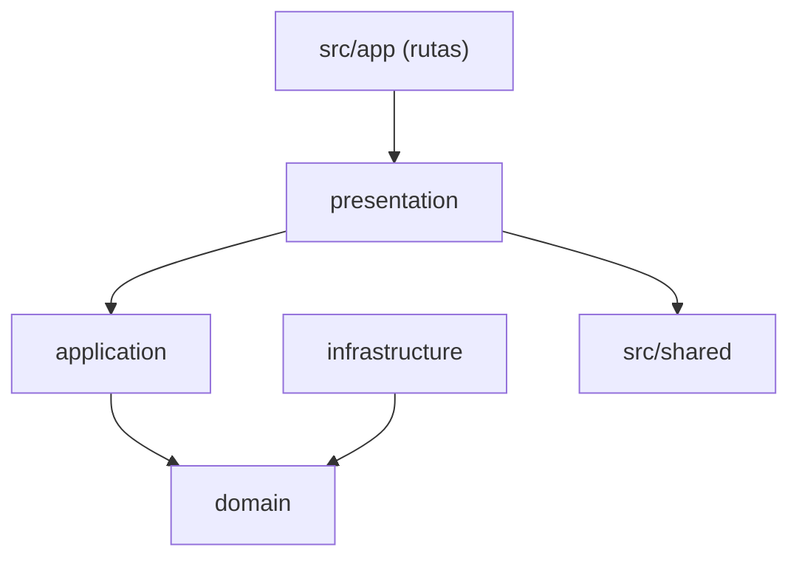

# Arquitectura de JobRadar ATS

Este documento distingue siempre entre lo **actual** (existe en el repositorio) y lo **planificado** (decisión tomada, aún sin implementar). Las reglas técnicas de Expo están en [AGENTS.md](../AGENTS.md) y no se repiten aquí.

## Decisión principal

**Arquitectura modular por funcionalidades con separación pragmática de capas.**

Cada funcionalidad del producto (ofertas, currículums, análisis, candidaturas…) será un módulo independiente. Dentro de cada módulo, el código se separa en capas conceptuales solo cuando hay contenido real para ellas.

## Estructura actual

Hoy el proyecto contiene la base técnica, el sistema de diseño de la Fase 2 (tokens y los componentes `Screen`, `Card`, `Icon`, `Button` y `TextField`) y la capa `domain` de los dos primeros módulos de funcionalidad, ambos de la Fase A: `cv-match`, el motor del analizador CV–oferta, y `cv-import`, la importación de CV. **El analizador todavía no tiene pantalla ni ruta, y aún no se pueden seleccionar ni leer archivos**: la presentación, la aplicación y la infraestructura, con sus dependencias, se incorporarán en bloques posteriores de la migración (ver [roadmap.md](roadmap.md)).

```text
src/
  app/                  # Rutas de Expo Router
    _layout.tsx         # Stack provisional, tema de navegación e import de global.css
    index.tsx           # Pantalla de inicio provisional: Screen, título y Card
  features/
    cv-match/domain/    # Motor del analizador CV–oferta, en TypeScript puro (ver más abajo)
    cv-import/domain/   # Reglas de la importación de CV, en TypeScript puro (ver más abajo)
  shared/ui/            # Componentes genéricos del sistema de diseño
    screen.tsx          # Contenedor de pantalla: fondo, áreas seguras, márgenes, scroll
    card.tsx            # Contenedor de contenido sobre una superficie
    icon.tsx            # Iconos con catálogo multiplataforma (expo-symbols)
    button.tsx          # Botón principal y secundario con estados accesibles
    text-field.tsx      # Campo de texto de una o varias líneas con etiqueta, ayuda, error y contador
    web-text-style.d.ts # Tipo de `fieldSizing`, estilo web que React Native no declara
  shared/theme/         # Tokens del sistema de diseño (fuente única)
    colors.ts           # Paletas semánticas claro/oscuro
    typography.ts       # Escala tipográfica y familias de fuentes
    fonts.ts            # Carga de Sora y contexto de disponibilidad
    layout.ts           # Espaciado, radios, tamaños de icono, área táctil y medidas de pantalla
    navigation.ts       # Temas de navegación derivados de las paletas
    index.ts            # Punto de entrada: @/shared/theme
  components/           # ThemedText (pendiente de migrar)
  constants/theme.ts    # Adaptador temporal que reexporta desde @/shared/theme
  hooks/                # useColorScheme (nativo y web) y useTheme
  global.css            # Variables de fuentes y áreas seguras de Screen en web
__tests__/              # Pruebas (fuera de src/app)
jest/style-mock.js      # Sustituto de los imports de CSS en Jest
assets/                 # Iconos y pantalla de bienvenida
  fonts/                # Sora SemiBold y Bold (OTF) y su licencia OFL.txt
```

`components/`, `constants/` y `hooks/` son código heredado de la plantilla. Ya leen sus valores de `src/shared/theme/`, pero su migración definitiva a `src/shared/` (y la eliminación del adaptador) queda para una tarea posterior de la Fase 2. `ThemedView` se eliminó en la Fase 2b.1b: `Screen` lo sustituye.

### Módulo `cv-match` (Fase A)

Compara el texto de un CV con el de una oferta, requisito por requisito. Por ahora solo existe su capa `domain`.

```text
src/features/cv-match/domain/
  analyze-match.ts       # Punto de entrada: analyzeMatch(cvText, offerText)
  offer-requirements.ts  # Requisitos de la oferta, con su importancia y sus frases de origen
  cv-structure.ts        # Secciones y frases del CV, y comprobaciones básicas (contacto, cifras)
  assess.ts              # Estado y evidencias de cada requisito
  coverage.ts            # Puntos y cobertura
  recommendations.ts     # Recomendaciones a partir del resultado
  compare.ts             # Cambios entre dos análisis
  criteria.ts            # Niveles de estudios, niveles de idioma (MCER) y años
  skill-catalog.ts       # Catálogo cerrado de habilidades, conocimientos e idiomas
  text.ts                # Normalización, líneas, frases y búsqueda de términos
  input.ts               # Campos que deben rellenarse antes de analizar
  types.ts               # Tipos del resultado
```

- **TypeScript puro.** Solo importa sus propios archivos. No depende de React, React Native, Expo, red, disco ni otros módulos, y no usa globales de plataforma. Se prueba en Jest sin renderizar nada (`__tests__/cv-match-*.test.ts`). Se ejecuta en el dispositivo y no guarda nada.
- **Requisitos.** De la oferta extrae conceptos del catálogo, idiomas con nivel, estudios mínimos y años de experiencia. Cada requisito conserva las frases literales de las que sale y su importancia (obligatorio, deseable, sin clasificar o ambigua). Las líneas que no reconoce se muestran como no evaluables.
- **Evidencias textuales.** Cada requisito queda respaldado (una frase de experiencia o proyectos describe su uso), mencionado (se nombra sin describir el uso), no acreditado o no evaluable. Siempre lleva el motivo en lenguaje claro y, cuando las hay, las frases literales del CV en que se basa. El conocimiento teórico, el aprendizaje en curso y las negaciones («Docker: sin experiencia») nunca cuentan como respaldo.
- **Cobertura explicable.** 1 punto por requisito respaldado, 0,5 por mencionado y 0 por no acreditado; los obligatorios pesan el doble. El porcentaje es la parte de los puntos posibles y se entrega con los puntos y los recuentos por estado. Los requisitos no evaluables no cuentan; si no se puede evaluar ninguno, no hay porcentaje.
- **Recomendaciones.** Se construyen con textos fijos y etiquetas de la oferta, nunca con contenido del CV, y no sugieren añadir experiencia, titulaciones ni habilidades que el usuario no tenga.

Limitaciones:

- **Motor heurístico.** Reglas y un catálogo cerrado escritos para JobRadar, sin IA. Lo que no está en el catálogo se marca como no evaluable en lugar de adivinarse.
- **Sin predicciones.** La cobertura mide los requisitos detectados en la oferta. No es la decisión de ningún ATS real ni una probabilidad de contratación.
- **Español.** Las reglas de importancia, negación y matización están escritas para textos en español; algunos encabezados del CV se reconocen también en inglés.
- **Solo texto.** Analiza texto ya escrito o pegado; no lee archivos.

### Módulo `cv-import` (Fase A)

Obtiene el texto de un CV en PDF o DOCX para analizarlo. Por ahora solo existe su capa `domain`: **en el proyecto original todavía no se puede seleccionar ni leer ningún archivo**, porque faltan las capas `application` e `infrastructure` (selector de archivos y lectores) y sus dependencias (`expo-document-picker`, `pdfjs-dist` y `mammoth`).

```text
src/features/cv-import/domain/
  detect-format.ts             # Formato por el contenido del archivo, no por su nombre
  assemble-pdf-text.ts         # Reconstrucción de líneas a partir de los fragmentos de texto de un PDF
  docx-html-to-text.ts         # Texto plano a partir del HTML sencillo que genera mammoth
  normalize-extracted-text.ts  # Normalización de caracteres y líneas, con recuento de cambios
  characters.ts                # Letras y caracteres ilegibles
  assess-extraction.ts         # Evaluación de la calidad de la extracción
  imported-cv.ts               # CV importado, correcciones del usuario y texto que se analiza
  readers.ts                   # Contrato de los lectores, que implementará cada plataforma
  types.ts                     # Tipos de formatos, fallos, avisos y estados
```

- **TypeScript puro.** Mismas condiciones que `cv-match`: solo importa sus propios archivos, sin React, Expo, red, disco, globales de plataforma ni otros módulos. Las librerías de lectura quedan detrás del contrato `CvReaders` de `readers.ts`. Se prueba en Jest (`__tests__/cv-import-*.test.ts`).
- **Identificación de formatos.** Por las firmas de su contenido: PDF, DOCX (un ZIP con `word/document.xml`), Word antiguo o protegido con contraseña, RTF y archivos vacíos. El nombre del archivo solo sirve para avisar si no coincide.
- **Normalización de texto.** Unifica saltos de línea, ligaduras, guiones suaves, caracteres invisibles, espacios especiales y líneas en blanco. Nunca elimina palabras, une líneas cortadas con guion ni recorta, y cuenta cada cambio.
- **Reconstrucción de líneas PDF.** Agrupa en líneas los fragmentos de texto con posición de cada página, con umbrales proporcionales al tamaño de letra. Conserva todo el texto y marca las páginas cuyo orden de lectura puede ser incorrecto, como en los diseños de varias columnas.
- **Texto de DOCX.** Convierte el HTML de mammoth en texto plano como una cadena: nunca se interpreta en un navegador, se inserta en la interfaz ni se ejecuta.
- **Evaluación de la extracción.** Distingue errores demostrados, que bloquean el análisis (sin texto, por ejemplo un PDF escaneado, o con un 30 % o más de caracteres ilegibles), avisos que piden revisar el texto (caracteres ilegibles, páginas sin texto, orden de lectura) y notas inciertas que solo se muestran (poco texto). Los umbrales son configurables y se tratan como criterios, no como certezas.
- **Gestión de correcciones.** El texto extraído no se modifica: la corrección del usuario se guarda aparte, se puede descartar y, si existe, es la que se analiza. Una corrección permite analizar un texto bloqueado, porque lo ha escrito el usuario.

## Estructura planificada

> **Planificado.** Salvo `src/shared/theme/`, `src/shared/ui/`, `src/features/cv-match/domain/` y `src/features/cv-import/domain/`, ninguna de estas carpetas existe todavía y no se crearán vacías: cada una aparecerá cuando haya código que ponga en ella.

```text
src/
  app/                      # Rutas ligeras: componen pantallas, sin lógica de negocio
  features/
    <feature>/              # Un módulo por funcionalidad
      domain/               # Entidades, reglas de negocio y contratos
      application/          # Casos de uso y coordinación de operaciones
      infrastructure/       # Persistencia, APIs y servicios concretos
      presentation/         # Pantallas, hooks y componentes visuales
  shared/                   # Código genérico reutilizado, solo con necesidad real
```

Los nombres de las funcionalidades se fijarán al implementarlas. No todos los módulos necesitarán las cuatro capas: un módulo sencillo puede empezar solo con `presentation/` y `domain/`.

### Responsabilidades de cada capa

| Capa             | Contiene                                                                     | No debe contener                                   |
| ---------------- | ---------------------------------------------------------------------------- | -------------------------------------------------- |
| `domain`         | Entidades, reglas de negocio puras y contratos (interfaces) de repositorios  | React, React Native, Expo, acceso a red o disco    |
| `application`    | Casos de uso que coordinan el dominio a través de sus contratos              | Componentes visuales ni implementaciones concretas |
| `infrastructure` | Implementaciones concretas de los contratos: almacenamiento, APIs, servicios | Reglas de negocio                                  |
| `presentation`   | Pantallas, hooks y componentes visuales que usan los casos de uso            | Reglas de negocio ni acceso directo a persistencia |

### Reglas de dependencia



- El **dominio no depende de nada**: ni de otras capas ni de librerías de UI o plataforma. Así las reglas del motor ATS se pueden probar de forma aislada.
- `infrastructure` **implementa** los contratos definidos en `domain`. `application` depende de esos contratos, no de las implementaciones.
- Las rutas de `src/app/` solo importan pantallas de `presentation` y se mantienen ligeras.
- **Sin acoplamiento entre funcionalidades:** un módulo no importa el código interno de otro. Si algo debe compartirse, se mueve a `src/shared/` o se expone de forma explícita y mínima.
- `src/shared/` no depende de ninguna funcionalidad.

Estas reglas todavía no se aplican de forma automática. Se valorará reforzarlas con reglas de ESLint en la Fase 6.

## Decisiones técnicas tomadas

| Decisión                                                                      | Motivo                                                                                                                                                                                                                                                                                                                                                                                                                                                                                                                       |
| ----------------------------------------------------------------------------- | ---------------------------------------------------------------------------------------------------------------------------------------------------------------------------------------------------------------------------------------------------------------------------------------------------------------------------------------------------------------------------------------------------------------------------------------------------------------------------------------------------------------------------- |
| Expo Router con rutas en `src/app/`                                           | Navegación basada en archivos, común a iOS, Android y web.                                                                                                                                                                                                                                                                                                                                                                                                                                                                   |
| Continuous Native Generation                                                  | `ios/` y `android/` se generan; la configuración nativa vive en `app.json` y en plugins de configuración.                                                                                                                                                                                                                                                                                                                                                                                                                    |
| TypeScript `strict` y alias `@/*` → `src/*`                                   | Detectar errores pronto e importar sin rutas relativas largas.                                                                                                                                                                                                                                                                                                                                                                                                                                                               |
| Rutas tipadas y React Compiler (`app.json` → `experiments`)                   | Comprobación de tipos en la navegación y memoización automática. Ambas son experimentales (ver riesgos).                                                                                                                                                                                                                                                                                                                                                                                                                     |
| `useColorScheme` web con `useSyncExternalStore`                               | Con `web.output: "server"`, el servidor renderiza en tema claro; el tema real se aplica tras la hidratación para evitar errores de hidratación.                                                                                                                                                                                                                                                                                                                                                                              |
| ESLint (`eslint-config-expo`) + Prettier, con `eslint-config-prettier`        | ESLint para errores y Prettier para el formato, sin reglas en conflicto.                                                                                                                                                                                                                                                                                                                                                                                                                                                     |
| Finales de línea LF (`.gitattributes` y `.prettierrc`)                        | Evitar diferencias de CRLF/LF al desarrollar desde Windows.                                                                                                                                                                                                                                                                                                                                                                                                                                                                  |
| Jest 30 + `jest-expo` + React Native Testing Library 14                       | Combinación indicada por la documentación de Expo SDK 58; `react-test-renderer` está obsoleto y no admite React 19.                                                                                                                                                                                                                                                                                                                                                                                                          |
| Tests en `__tests__/`, stub de CSS en `jest/style-mock.js`                    | Expo Router reserva `src/app/` para rutas, y Jest no puede interpretar el CSS que importa el layout raíz.                                                                                                                                                                                                                                                                                                                                                                                                                    |
| `"types": ["jest"]` en `tsconfig.json`                                        | Hacer visibles a TypeScript los globales de Jest (`describe`, `it`, `expect`).                                                                                                                                                                                                                                                                                                                                                                                                                                               |
| Tokens de diseño en `src/shared/theme/`, sin librería de estilos              | Una sola fuente de verdad sin dependencias nuevas. Ningún color hexadecimal vive fuera de `colors.ts`.                                                                                                                                                                                                                                                                                                                                                                                                                       |
| Paletas semánticas claro/oscuro seleccionadas con `useTheme()`                | Los componentes usan nombres de intención (`surface`, `accentText`), no colores. El esquema sale del `useColorScheme` seguro para hidratación.                                                                                                                                                                                                                                                                                                                                                                               |
| Contraste verificado por tests (`__tests__/theme-contrast.test.ts`)           | Texto ≥ 4,5:1 y controles ≥ 3:1 (WCAG 2.2 AA). Los bordes decorativos están exentos, pero no pueden ser la única señal visual.                                                                                                                                                                                                                                                                                                                                                                                               |
| Sin límite de escalado de texto (`maxFontSizeMultiplier`)                     | Priorizar maquetas flexibles. Cualquier límite futuro deberá justificarse en el componente concreto.                                                                                                                                                                                                                                                                                                                                                                                                                         |
| `global.css` importado solo en `src/app/_layout.tsx`                          | Orden de carga correcto del CSS global, como indica Expo Router.                                                                                                                                                                                                                                                                                                                                                                                                                                                             |
| Adaptadores temporales (`constants/theme.ts`, variantes de ThemedText)        | Migrar por pasos sin romper los componentes existentes; reexportan o reutilizan los tokens, sin duplicar valores.                                                                                                                                                                                                                                                                                                                                                                                                            |
| Sora solo en títulos y cifras (`displaySteps`); sistema en el resto           | Personalidad en los titulares sin perder la legibilidad ni el escalado de la fuente del sistema. SemiBold 600 en títulos, Bold 700 en cifras.                                                                                                                                                                                                                                                                                                                                                                                |
| Sora como una familia con dos pesos, cargada con `useFonts` en el layout raíz | Patrón de Expo SDK 58. Llamado durante el render para que el servidor web incruste `@font-face` y `preload` en el HTML, sin errores de hidratación.                                                                                                                                                                                                                                                                                                                                                                          |
| Sin bloqueo indefinido: se renderiza con `loaded` o con `error`               | El splash nativo se mantiene mientras carga. Si la carga falla, la app sigue con la fuente del sistema (`DisplayFontContext` en `false`).                                                                                                                                                                                                                                                                                                                                                                                    |
| Respaldo web `Sora, system-ui, sans-serif` (sin variables CSS)                | En desarrollo el HTML del servidor no incluye `global.css`; una variable sin definir invalidaba la declaración y mostraba Times New Roman.                                                                                                                                                                                                                                                                                                                                                                                   |
| `Screen` como único punto que aplica áreas seguras                            | Nativo: `useSafeAreaInsets()` del proveedor de Expo Router, sumado a los márgenes de la app. Web: `env(safe-area-inset-*)` en la clase `.screen-safe-area`, porque en SDK 58 el hook devuelve cero en web. Sin segundo `SafeAreaProvider`. En la Fase 3 dejará de aplicar los bordes que cubran cabeceras o pestañas nativas.                                                                                                                                                                                                |
| `Screen` con scroll vertical por defecto                                      | Todo el contenido sigue siendo alcanzable con texto ampliado o pantallas pequeñas. Contenido limitado a 800 px y centrado.                                                                                                                                                                                                                                                                                                                                                                                                   |
| `Icon` con un catálogo cerrado de nombres semánticos                          | Cada nombre se traduce una vez a SF Symbols (iOS) y Material Symbols (Android y web); TypeScript rechaza nombres inexistentes en cualquier plataforma. Se usan variantes con contorno en iOS para igualar la fuente Material. El catálogo crece solo cuando una pantalla lo necesita.                                                                                                                                                                                                                                        |
| `Icon` decorativo por defecto, informativo con `label`                        | Sin `label` se oculta a las tecnologías de asistencia (solo el icono, nunca su contenedor); con `label` se expone como imagen con nombre. Colores siempre desde el tema y tamaños desde `iconSize` (16, 20, 24).                                                                                                                                                                                                                                                                                                             |
| `Button` con dos variantes (`primary`, `secondary`)                           | Acción principal de marca y alternativa sobre superficie con borde de control (≥ 3:1). `ghost` y `destructive` se añadirán con su primer uso real. Texto `headline`, relleno horizontal `space[4]` (16), altura mínima `layout.minTouchTarget` (44) y crecimiento vertical sin truncar el texto.                                                                                                                                                                                                                             |
| Estados de `Button` con props `aria-*`                                        | `aria-disabled` y `aria-busy` llegan tanto a los estados nativos como al DOM web (React Native Web ignora `accessibilityState`). Desactivado: sin pulsaciones, fuera del orden de tabulación y con colores neutros comunes a ambas variantes (`neutralSubtle`, `border`, `textSecondary`; texto ≥ 6:1) en lugar de opacidad, que dejaba el texto por debajo de 2,3:1. Cargando: sin pulsaciones, mismo tamaño, indicador centrado y **sigue enfocable**, para que el teclado y el lector de pantalla no pierdan su posición. |
| Foco visible solo con teclado en web                                          | El anillo `focusRing` se muestra cuando el foco cumple `:focus-visible`; un clic de ratón no lo muestra. Antes de la hidratación se ve el anillo por defecto del navegador.                                                                                                                                                                                                                                                                                                                                                  |
| `Button` nunca más ancho que su contenedor                                    | `maxWidth: '100%'`; con poco espacio el icono pasa encima del texto y, en último extremo, la palabra se parte en lugar de desbordar (WCAG 1.4.10).                                                                                                                                                                                                                                                                                                                                                                           |
| `Card` sin variantes ni interacción                                           | Un único aspecto (superficie, borde decorativo, `radius.lg`). No marca `accessible`, así que no fusiona a sus hijos para los lectores de pantalla. Las variantes llegarán con su primer uso real.                                                                                                                                                                                                                                                                                                                            |
| Título de pantalla fuera de las tarjetas                                      | El título pertenece a la pantalla. Evita que el relleno de la tarjeta reduzca el ancho disponible: con zoom del 200 %, «JobRadar» cabe en una línea sin reducir el tamaño de letra.                                                                                                                                                                                                                                                                                                                                          |
| `TextField` controlado y sin reglas de validación                             | Solo representa `value`, `helperText` y `error`. Las reglas serán funciones de `domain` de cada funcionalidad y la capa `presentation` decidirá cuándo mostrar el error. Pauta prevista: validar al salir del campo y al enviar; con el error visible, revalidar al escribir.                                                                                                                                                                                                                                                |
| Orden visual de `TextField`: etiqueta, campo, error y ayuda                   | El error aparece justo debajo del campo, con icono y color `danger`, y la ayuda debajo. El orden del DOM y de `aria-describedby` es el mismo (error y después ayuda), igual que la indicación nativa. Etiqueta en `headline`, campo a 17 px (`body`, sin `lineHeight`, que descoloca el texto en iOS) y mensajes en `callout` (15 px): explican cómo corregir el valor y deben leerse bien en el móvil. Con 17 px Safari en iPhone no amplía la página al enfocar.                                                           |
| Nombre y descripción accesibles de `TextField`                                | La etiqueta visible sigue siendo legible por sí misma. Nombre: `accessibilityLabel` (iOS) y `aria-labelledby` hacia la etiqueta (Android y web). Web: `aria-describedby` hacia el error y la ayuda, y `aria-invalid`. iOS y Android no tienen equivalente: los mismos mensajes van en `accessibilityHint`, con el error primero y el prefijo «Error:». No se usa `aria-errormessage` para no leer el error dos veces.                                                                                                        |
| Pulsar la etiqueta enfoca el campo                                            | Como una etiqueta HTML: la etiqueta llama a `focus()` del campo (salvo si está desactivado). En web solo añade el clic y el cursor de puntero, sin otra parada de tabulación. `TextField` guarda su propia referencia al campo y entrega la misma instancia a quien la pide (`useImperativeHandle`).                                                                                                                                                                                                                         |
| Atributos web sin tipos (`aria-describedby`, `aria-invalid`)                  | Los tipos de React Native 0.88 no los declaran. JSX admite nombres con guion sin conversión de tipos; React Native Web los escribe en el DOM e iOS y Android los ignoran. TypeScript no comprueba sus valores, así que los cubren los tests y la verificación del DOM.                                                                                                                                                                                                                                                       |
| Identificadores de `TextField` solo tras la hidratación                       | En web, `useId` da valores distintos en el servidor y en el cliente de Expo Router: tras la primera actualización, `aria-describedby` apuntaba a un id inexistente (comprobado en producción). Los ids se generan solo tras hidratar (`useSyncExternalStore`, como `useColorScheme`); mientras tanto el campo ya tiene nombre por `aria-label`.                                                                                                                                                                              |
| Anuncio del error de `TextField`                                              | Región en vivo educada (`aria-live="polite"`) siempre montada y solo alrededor del error: se anuncia cuando aparece (web y Android), no al cargar la página. El icono es decorativo. iOS no tiene regiones en vivo.                                                                                                                                                                                                                                                                                                          |
| Foco de `TextField` sin desplazamiento                                        | Borde fijo de 1 px y, con foco, sombra interior de 1 px del mismo color (2 px visibles) que no ocupa espacio. Con un borde de 2 px compensado con relleno, el navegador redondeaba los bordes y el texto se movía 0,2 px. El anillo propio del navegador se anula (`outlineStyle: 'solid'`, ancho 0) y, con foco, un contorno transparente de 2 px queda visible en los modos de alto contraste, que eliminan las sombras. El foco se marca siempre, también con ratón, como en los campos de texto nativos.                 |
| `TextField` desactivado                                                       | No editable (`editable={false}`), `aria-disabled`, fuera del orden de tabulación y con los colores neutros de `Button` (`neutralSubtle`, `border`, `textSecondary`).                                                                                                                                                                                                                                                                                                                                                         |
| Textos completos en `TextField`, sin límite por defecto                       | Las ofertas se pegan completas, aunque tengan decenas de miles de caracteres, porque la futura lógica ATS debe analizar toda la descripción. El componente no usa `maxLength` ni recorta, resume o normaliza el texto: devuelve lo que recibe el campo. La única transformación es la del navegador, que guarda los saltos `\r\n` pegados como `\n`. `characterLimit` es opcional y nunca recorta.                                                                                                                           |
| Altura de `TextField` multilínea                                              | De 6 a 12 líneas de `body` (170 a 314 px en web), con `lineHeight` de 24 y texto alineado arriba (`textAlignVertical`, necesario en Android). Al llegar al máximo, el campo se desplaza por dentro. En iOS y Android las alturas siguen el tamaño de texto del usuario (`fontScale`), con un tope del 45 % de la ventana y un mínimo de 3 líneas; la altura mínima nunca supera la máxima. En web el zoom del navegador ya las escala, y el servidor no conoce la ventana.                                                   |
| Crecimiento sin medir en JavaScript                                           | iOS y Android ajustan un campo multilínea a su texto entre `minHeight` y `maxHeight`. En web, `field-sizing: content` (Baseline desde junio de 2026: Chrome 123, Safari 26.2, Firefox 152). Se descartó `onContentSizeChange`: React Native Web lee `scrollHeight` en cada pulsación y el campo no encoge al borrar. Sin `field-sizing`, el campo se queda en la altura mínima con scroll interno.                                                                                                                           |
| Tipo de `fieldSizing` por ampliación de módulo                                | `web-text-style.d.ts` añade `fieldSizing?: 'fixed' \| 'content'` a `TextStyle`, sin conversiones de tipos. React Native Web lo pasa al CSS (comprobado). Solo se aplica con `EXPO_OS === 'web'`, así que iOS y Android no lo reciben.                                                                                                                                                                                                                                                                                        |
| Contador opcional de `TextField`                                              | Solo con `characterLimit`. Va en su propia línea, alineado a la derecha, tras el error y la ayuda: «2.450 / 5.000» en `callout` con cifras tabulares. Agrupa los miles también con 4 cifras, sin `Intl`, que en español no agrupa 2450 y podría dar otro resultado en el servidor. Cuenta unidades UTF-16 (`value.length`): un emoji cuenta 2. Se lee como «2450 de 5000 caracteres.», sin separadores, y se enlaza tras el error y la ayuda (`aria-describedby` en web, indicación en iOS y Android).                       |
| Superar el límite del contador                                                | Contador en `danger`, icono decorativo y «Límite superado». No recorta, no marca el campo como inválido ni cambia el borde: si debe impedir el envío, la pantalla pasa un `error` con otro texto. El aviso está en una región en vivo educada aparte, siempre montada: se anuncia una vez al cruzar el límite (web y Android) y las cifras nunca se anuncian. iOS queda pendiente de las pruebas nativas.                                                                                                                    |

## Restricciones de producto que afectan al diseño

- **Puntuación explicable:** el motor debe devolver, junto a cada puntuación, los criterios aplicados y las evidencias encontradas en el CV y la oferta. Esta lógica pertenece a la capa `domain` (hoy, la de `cv-match`).
- **Sin predicciones:** ningún texto ni cálculo debe presentar el resultado como la decisión que tomaría un ATS real.
- **Sin invención de datos:** las recomendaciones y la edición de CV no pueden añadir experiencia, titulaciones ni habilidades que el usuario no haya aportado.
- **Datos personales:** los CV contienen datos personales. Cualquier almacenamiento, envío a servicios externos o uso de IA deberá justificarse y evaluarse en términos de privacidad (RGPD) antes de implementarse.

## Riesgos técnicos conocidos

### Avisos de `npm audit`

Situación a 1 de noviembre de 2026: **46 avisos (45 moderados y 1 bajo, ninguno alto ni crítico)**. Todos proceden de tres paquetes transitivos:

| Paquete     | Gravedad | Aviso                                                                                                    | Llega a través de                            |
| ----------- | -------- | -------------------------------------------------------------------------------------------------------- | -------------------------------------------- |
| `glob`      | Moderada | [GHSA-3g3m-2fjr-6pw4](https://github.com/advisories/GHSA-3g3m-2fjr-6pw4) (versiones 9.0.0 a 14.0.1)      | Herramientas de Expo CLI y compilación, Jest |
| `minimatch` | Moderada | [GHSA-g3hv-75wg-m249](https://github.com/advisories/GHSA-g3hv-75wg-m249) (versiones anteriores a 11.0.1) | ESLint y sus plugins, `glob`, Jest           |
| `deepmerge` | Baja     | [GHSA-gcqx-w48m-w2h4](https://github.com/advisories/GHSA-gcqx-w48m-w2h4) (versiones 4.2.0 a 4.3.1)       | `jest-config` (solo pruebas)                 |

**Desarrollo y compilación frente a código ejecutado por el usuario.** npm cuenta 29 de los 46 avisos dentro de `dependencies`, pero esa clasificación no demuestra que el código vulnerable llegue a la app. Paquetes como `expo` o `expo-splash-screen` incluyen también herramientas de línea de comandos y plugins de configuración que solo se ejecutan en el equipo de desarrollo o durante la compilación. Indicios disponibles:

- `glob`, `minimatch` y `deepmerge` son utilidades de Node.js para el sistema de archivos y la configuración, propias de herramientas de desarrollo.
- En la compilación web (`npx expo export --platform web`) no aparece ninguna referencia por nombre a `minimatch`, `deepmerge` ni `glob`. Es un indicio, no una prueba: no se han analizado los bundles nativos de iOS y Android.

**Tratamiento pendiente:**

- No se ha aplicado ninguna corrección. `npm audit fix --force` propone bajar a `expo@51` y `eslint@4`, que es incompatible con el proyecto y no se debe ejecutar.
- Revisar de nuevo cuando Expo publique actualizaciones del SDK 58 (`npx expo install --fix`) y cuando ESLint y Jest actualicen esas dependencias.
- Revisar el aviso de `deepmerge`: npm indica que hay una corrección sin cambios incompatibles, pero no se ha comprobado qué actualizaría.
- Confirmar en la Fase 6 qué dependencias llegan a los bundles nativos.

### Otros riesgos

- **PWA y `web.output: "server"`.** La configuración actual genera una salida con servidor. Una PWA en un alojamiento gratuito suele requerir salida estática (`"static"`). Se estudiará en la fase de la PWA.
- **Pruebas en iOS desde Windows.** No hay simulador de iOS en Windows y la versión de Expo Go disponible en la App Store no es compatible directamente con Expo SDK 58. La estrategia actual es desarrollar con Expo Web, probar la interfaz desde Safari en el iPhone y preparar una PWA en la Fase 5b. Así no se verifica el comportamiento nativo en iOS. Instalar compilaciones de desarrollo en un iPhone propio con una cuenta gratuita de Apple requiere Xcode en un Mac, procedimiento que no se usará por ahora; TestFlight y la App Store requieren una membresía de pago, que no se contratará.
- **Funciones experimentales.** `typedRoutes` y `reactCompiler` están marcadas como experimentales en `app.json` y pueden cambiar entre versiones del SDK.
- **Destello de tema claro en web con modo oscuro.** El servidor renderiza siempre en claro y el tema real se aplica tras la hidratación. No hay errores de hidratación, pero en la primera carga quien usa el modo oscuro ve brevemente el tema claro (comprobado: el HTML del servidor solo contiene colores claros). Comportamiento previo a la Fase 2; su corrección (por ejemplo, fondo con `prefers-color-scheme` en `src/app/+html.tsx`) está pendiente de autorización.
- **Salto de maquetación de `Screen` en desarrollo (web).** En desarrollo, el HTML del servidor no incluye `global.css`: hasta que llega, el contenedor web de `Screen` no es flex y el contenido aparece arriba antes de centrarse. En producción no ocurre porque el CSS está enlazado en el `<head>`.
- **`Screen` sin verificar en nativo.** Áreas seguras, scroll y teclado se han comprobado en Jest (cálculo y props) y en Expo Web (desarrollo y producción), no en iOS ni Android.
- **Sora en Android 9 y anteriores.** Cargada en tiempo de ejecución, Android por debajo de la API 29 solo registra una cara por familia, así que las cifras en Bold se verían en SemiBold. La solución es el plugin de configuración de `expo-font` en `app.json`, que solo funciona en compilaciones nativas.
- **Sora sin verificar en nativo.** La carga se ha comprobado en Expo Web (desarrollo y producción). En iOS y Android no se ha podido verificar por falta de un entorno nativo compatible con el SDK 58.
- **Palabras más largas que la línea con texto muy ampliado.** Resuelto para «JobRadar» al 200 % (Fase 2b.1b). Una palabra más ancha que toda la línea disponible (por ejemplo, «Recomendaciones» en un título al 200 %) seguirá partiéndose: no se pierde contenido (WCAG 1.4.10), pero podría suavizarse con separación silábica en web y Android. iOS no la ofrece en React Native.
- **Duplicado de `test-renderer`.** Conviven las versiones 1.3.0 (de `jest-expo`) y 1.3.1 (de React Native Testing Library). Hoy no causa fallos; vigilar si aparecen errores extraños en las pruebas.
- **Instalación en Windows.** `npx expo install <paquetes> "--" --dev` dejó los paquetes en `dependencies` en lugar de `devDependencies`. Hay que revisar `package.json` tras cada instalación.
- **Fuente de iconos en web y Android (a revisar antes de publicar la PWA).** `expo-symbols` dibuja los iconos con Material Symbols: un archivo de 950 KB sin comprimir (unos 426 KB con gzip) que se descarga tras la hidratación, cuando aparece el primer icono. Medido en web: sin desplazamientos de layout (la caja del icono ya tiene su tamaño) y sin errores; en una recarga solo se revalida (300 bytes). Pendiente para la Fase 5b: compresión y caché de larga duración en el alojamiento (el nombre lleva hash) y decidir si precargarla. El servidor local `expo serve` no comprime y usa `max-age=0`.
- **Iconos con texto grande en Android (sin verificar).** En Android el icono es un `Text` que escala con el tamaño de letra del sistema dentro de una caja fija, por lo que podría recortarse. No se ha adaptado sin validación nativa.
- **`Icon` sin verificar en nativo.** El aspecto de SF Symbols en iOS y de Material Symbols en Android, VoiceOver y TalkBack solo se han comprobado mediante Jest (nombres, tamaños, colores y props de accesibilidad).
- **Etiquetas de botón con zoom extremo.** Con zoom del 200 % (medido con emulación móvil), un botón a ancho completo dispone para el texto de 121 px (390) o 114 px (375) fuera de una tarjeta y de 88 u 80 px dentro. Las palabras más largas probadas caben fuera de las tarjetas; dentro, «Desactivado» (94 px) se partiría en 390 y también «Secundario» (87 px) en 375. A 320 px con 200 % hay solo 78 px fuera de tarjeta. No se pierde contenido ni hay desbordamiento. Pautas para pantallas: apilar las acciones verticalmente cuando no quepan en fila, preferir botones a ancho completo, etiquetas concisas y evitar anidar rellenos en anchos estrechos.
- **`Button` sin verificar en nativo.** Estados, pulsaciones y accesibilidad se han comprobado con Jest (`userEvent`, que recorre la secuencia real de `Pressable`) y en Expo Web; el estado pulsado solo en web. VoiceOver, TalkBack, háptica y el aspecto nativo no se han podido verificar.
- **`TextField` sin verificar en nativo.** Nombre, ayuda, error, foco, teclado y colores se han comprobado con Jest y en Expo Web (DOM, árbol de accesibilidad de Chromium, teclado y alto contraste). Pendiente en iOS y Android (incluido si pulsar la etiqueta enfoca el campo y cómo lo anuncian VoiceOver y TalkBack):
  - **Lectores de pantalla.** Si VoiceOver y TalkBack leen bien la etiqueta y los mensajes, que se oyen como texto y también como nombre e indicación del campo.
  - **Indicaciones desactivadas.** Si el usuario desactiva las indicaciones, el error solo llega al recorrer los textos visibles.
  - **iOS no anuncia el error al aparecer.** Lo tendrá que resolver el formulario de la Fase 5, por ejemplo con `AccessibilityInfo.announceForAccessibility` o moviendo el foco.
  - **Aspecto.** La sombra interior y el contorno en nativo, y los colores de cursor y selección.
  - **Teclado.** El teclado en iPhone y Android (incluido edge-to-edge) y el autocompletado.
- **Separación entre campos.** `TextField` no añade márgenes externos. Con la ayuda y el error debajo del campo, un formulario debe separar los campos más que la etiqueta de su campo (8 px), por ejemplo con `space[6]` (24 px). Si no, la ayuda parece de la etiqueta siguiente. La galería usa 24 px; el espacio por defecto de `Card` (8 px) no basta para formularios.
- **`TextField` muy estrecho.** A 320 px con zoom del 200 % el campo mide 78 px dentro de una tarjeta: el texto largo se desplaza dentro del campo, como en cualquier campo de una línea. Las etiquetas con palabras más largas que la línea se parten (por ejemplo, «Responsabilidades»), sin perder contenido.
- **Ids web de `TextField` antes de hidratar.** El HTML del servidor no enlaza la etiqueta, la ayuda, el error ni el contador; el campo ya tiene nombre por `aria-label` y los enlaces aparecen tras hidratar.
- **`TextField` multilínea sin verificar en nativo.** Solo comprobado con Jest y en Expo Web. Pendiente en iOS y Android:
  - **Crecimiento y scroll.** Que el campo crezca solo entre sus alturas y que, en el máximo, el gesto desplace el texto y no la pantalla (en Android depende de que el campo retenga el gesto dentro del `ScrollView`).
  - **Teclado y cursor.** Que el cursor quede visible con el teclado abierto.
  - **Aspecto.** `lineHeight`, relleno y alineación arriba reales.
  - **Rendimiento con textos largos.** Un campo controlado de 50.000 o 100.000 caracteres devuelve el valor completo al nativo en cada pulsación: puede haber retraso o saltos del cursor. No se ha medido y no se debe dar por bueno.
  - **Lectores de pantalla.** Si VoiceOver y TalkBack leen el valor completo al enfocar, y si TalkBack anuncia una sola vez «Límite superado». iOS no anuncia el cruce del límite, igual que el error.
- **Rendimiento de `TextField` en web (medido).** Chromium de escritorio con la galería temporal, que vuelve a dibujar a la vez varios campos con textos largos, así que es más exigente que un formulario real. Pegar con el portapapeles real: 4 a 67 ms entre 5.000 y 100.000 caracteres (6 a 189 ms con la CPU ralentizada 4×). Por pulsación, incluida la espera al siguiente fotograma: mediana de 10 a 14 ms y p95 de 25 a 33 ms, que con la CPU 4× suben a una mediana de 42 a 68 ms y un p95 de 80 a 131 ms (máximo de 163 ms con 50.000). En todos los casos el texto quedó idéntico tras pegar, escribir, editar en medio y borrar, el cursor en su sitio y sin saltos de scroll. Sin medir en Firefox. Si un formulario real fuese lento con textos muy largos, se estudiará antes de cambiar la API o introducir límites.
- **`TextField` en Safari del iPhone (revisión manual parcial).** En la galería temporal (Expo Web por la red local), el diseño, los errores, los contadores y el modo oscuro se vieron correctamente, y un texto de 50.000 caracteres cargado desde un botón se mostró bien. **Pendiente:** copiar, pegar, editar y borrar textos extensos en Safari, y medir allí el pegado y la escritura. Las mediciones de Chromium no sustituyen esta prueba. Para repetirla hará falta permitir temporalmente el puerto 8081 en el Firewall de Windows (perfil privado, solo red local) y retirar la regla al terminar.
- **Navegadores sin `field-sizing`** (por ejemplo, Safari anterior a 26.2). El campo multilínea no crece: se queda en 6 líneas con scroll interno, sin perder texto (comprobado anulando la propiedad).
- **Copiar en Windows.** El portapapeles de Windows guarda los saltos como `\r\n`; al pegar, el navegador los vuelve a guardar como `\n`. El texto es el mismo; solo cambia el carácter de salto.
- **Textos del contador en español fijo.** «de», «caracteres» y «Límite superado» están escritos en el componente, igual que el resto de la interfaz, que no tiene i18n.
- **Idioma del documento web.** Sin `src/app/+html.tsx`, Expo Router declara la página en inglés (`lang="en"`) aunque la interfaz esté en español, y un lector de pantalla puede pronunciarla en inglés. Por eso el contador se lee sin separadores de miles. Se corregirá al crear `+html.tsx`, que necesita autorización.
- **Riesgos futuros.** La importación de PDF/DOCX y la IA local o gratuita dependerán de librerías que habrá que validar con Expo SDK 58, iOS, Android, la web y la privacidad de los datos.

## Cuestiones pendientes no técnicas

- **Licencia.** La licencia propia de JobRadar ATS está pendiente de decisión. El repositorio es privado. El archivo `LICENSE` actual es la licencia MIT de la plantilla de Expo (copyright de 650 Industries, Inc.) y se conserva sin modificaciones. Al elegir la licencia propia, deberán mantenerse los avisos y atribuciones de terceros que correspondan.
